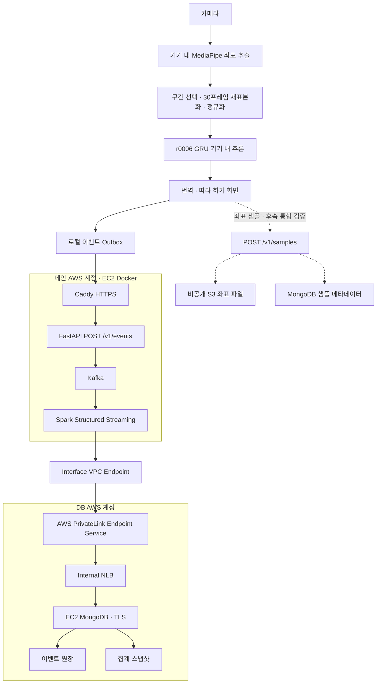

# 수어 칠판 · KSL Board

카메라로 수어 단어를 읽고, 본보기 동작을 따라 연습하며, 학습 기록을 AWS에 수집하는 모바일 팀 프로젝트입니다. iOS와 Android에서 동작 좌표를 추출하고 기기에서 단어를 판정합니다. 서버는 학습 이벤트를 Kafka와 Spark로 처리해 MongoDB 원장과 통계로 보관합니다.

**1차 마감 초안 · 2026-11-25 · 개발 및 내부 시험 단계**

| 구성 | 구현 내용 |
|---|---|
| iOS | SwiftUI 화면, MediaPipe 좌표 추출, Core ML 추론, SceneKit 본보기, 이벤트 재전송 |
| Android | Expo·React Native 앱, WebView 내부 MediaPipe·JavaScript GRU 추론, 이벤트 재전송 |
| 서버 | Caddy HTTPS, FastAPI 이벤트 배치 API, Kafka, Spark Structured Streaming |
| DB·네트워크 | 별도 AWS 계정의 EC2 MongoDB, PrivateLink, TLS 인증, 이벤트 원장·집계 저장 |
| 실제 연동 | 아이폰·안드로이드 학습 기록의 MongoDB 도착과 아이폰 2대 동시 사용 시험 |

## 목차

- [프로젝트 배경과 목표](#프로젝트-배경과-목표)
- [사용자 기능](#사용자-기능)
- [전체 아키텍처](#전체-아키텍처)
- [기술 스택과 선택](#기술-스택과-선택)
- [모델과 좌표 처리](#모델과-좌표-처리)
- [학습 이벤트 수집](#학습-이벤트-수집)
- [MongoDB 저장과 최적화](#mongodb-저장과-최적화)
- [검증 결과](#검증-결과)
- [역할과 협업](#역할과-협업)
- [실행 및 문서](#실행-및-문서)
- [1차 마감 범위와 후속 작업](#1차-마감-범위와-후속-작업)

## 프로젝트 배경과 목표

처음 수어를 접하는 사용자가 본보기 동작을 보고 따라 하면서 인식 결과를 확인할 수 있는 앱을 만들었습니다. 모바일 추론과 함께 실제 학습 흐름을 기록하는 수집 경로를 구축해, 어떤 단어에서 시도와 실패가 발생하는지 확인할 기반을 마련했습니다.

1. 카메라 입력에서 손·상체 좌표를 추출하고 5개 목표 단어와 기타 동작을 판정합니다.
2. 번역 화면에서 읽은 단어와 후보를 확인하고, 학습 화면에서 본보기를 따라 연습합니다.
3. 연결이 일시적으로 끊겨도 학습 기록을 기기에 보관하고 재전송합니다.
4. 앱 이벤트를 서버·Kafka·MongoDB에서 같은 ID로 추적하고, 집계의 근거를 원장에 남깁니다.

현재 기능은 제한된 어휘의 단어 인식과 따라 하기입니다. 연속 수어 문장의 번역, 실사용자 전체에 대한 정확도, 공인된 수어 교육 효과는 후속 검증 대상입니다.

## 사용자 기능

| 기능 | 동작 |
|---|---|
| 단어 읽기 | 동작 구간을 시작·종료해 판정된 단어와 신뢰도를 표시 |
| 판정 상세 | 후보 확률, 손 검출 상태, 동작 길이 확인 |
| 본보기 학습 | 커피·춥다·우유·감사·자다의 본보기를 보고 따라 하기 |
| 학습 진도 | 목표 단어 인식 결과에 따라 진행 상태 기록 |
| 사용자 확인 | 번역 결과를 확인하거나 다른 단어로 수정한 기록 수집 |
| 자동 동기화 | 기록을 먼저 로컬 큐에 넣고 서버 응답에 따라 삭제·재시도 |

iOS는 SceneKit 3D 본보기를 회전해 볼 수 있습니다. Android는 해당 본보기를 렌더링한 프레임을 재생하며, 회전 가능한 3D 장면은 iOS 구현 범위입니다.

## 전체 아키텍처

실선은 학습 이벤트의 검증된 적재 경로입니다. 점선은 S3 권한과 실제 샘플 저장을 검증해야 하는 후속 경로입니다. 카메라 영상은 저장·전송하지 않고 기기에서 좌표를 추출합니다. 좌표 샘플의 전송은 이벤트 전송과 별도입니다.

## 기술 스택과 선택

| 영역 | 기술 | 적용 목적 |
|---|---|---|
| iOS | Swift, SwiftUI, AVFoundation, MediaPipe, Core ML, SceneKit | 카메라 처리, 단말 추론, 학습 UI·본보기 |
| Android | Expo, React Native, WebView, MediaPipe Tasks Vision, JavaScript | Android에서 같은 좌표 규격과 모델 계산 구현 |
| API | Python, FastAPI | 이벤트 종류별 입력 검증, 인증, 배치 수신 |
| HTTPS | Caddy, Let’s Encrypt | 모바일 요청의 전송 암호화 |
| 메시지 | Apache Kafka | 이벤트 버퍼링, 소비 위치 추적, 재처리 기반 |
| 스트림 처리 | Spark Structured Streaming | 이벤트 소비, 시간 창 집계, 체크포인트 |
| 저장 | MongoDB, PyMongo | 이벤트 ID 기반 원문 보관과 집계 조회 |
| AWS | EC2, Elastic IP, PrivateLink, Internal NLB | 실행 환경, 고정 관리 주소, 계정 간 사설 접속 |
| 실행 관리 | Docker, Docker Compose | API·메시지·스트림 작업의 실행 환경 관리 |

기술별 배포 구조와 판단은 [아키텍처 문서](docs/architecture.md)에 정리했습니다.

## 모델과 좌표 처리

| 항목 | 현재 구현 |
|---|---|
| 모델 | `r0006`, GRU 기반 단어 분류 |
| 출력 순서 | 기타 → 커피 → 춥다 → 우유 → 감사 → 자다 |
| 프레임 규격 | 양손 21점씩 + 상체 17점 = 59점, 각 점의 x·y·z로 177개 값 |
| 입력 | 선택한 동작을 30프레임으로 재표본화한 `30 × 177` |
| 전처리 | 화면 비율 반영, 어깨 중심·너비 기준 정규화, 미검출 입력 처리 |
| 구간 | 약 0.5~3초, 번역 버튼 방식과 따라 하기 자동 구간 처리 |
| iOS 추론 | Core ML 모델 |
| Android 추론 | 변환한 가중치를 사용하는 JavaScript GRU 계산 |
| 표시 기준 | 제공 코드의 확신 표시 임시 기준 `0.6`, 동작 손 미검출 비율 기준 `0.5` |

초기 설계의 `0.85`와 제공 앱 코드의 `0.6`은 시점과 역할이 다릅니다. 위 표는 제공된 코드 기준입니다. 모델 확률을 실제 정확도로 해석하지 않으며, 현재 임시 기준은 별도 평가셋으로 확정해야 합니다.

좌우를 뒤집은 좌표도 판정하는 보완 로직이 포함돼 있습니다. 본보기의 정확성과 좌우 보완의 오검출 영향은 후속 평가 대상입니다.

## 학습 이벤트 수집

앱은 재전송에서도 같은 `event_id`를 유지합니다. API는 최대 100건의 이벤트 배치를 검증하고 Kafka 발행 성공을 확인한 뒤 HTTP `202`를 반환합니다. `202`는 Kafka 발행 확인 시점의 수락을 뜻하며, MongoDB 적재는 뒤따르는 비동기 작업에서 확인합니다.

| 기록 | 용도 |
|---|---|
| `lesson_started` | 학습 시작 |
| `practice_attempt` | 연습 시도 |
| `recognition_result` | 단어 판정·미인식 결과 |
| `retry` | 실패 후 재시도 |
| `lesson_completed` | 목표 학습 완료 |
| `lesson_ended` | 학습 종료 |
| `answer_selected` | 사용자의 번역 결과 확인·수정 |

서버는 `event_time`, `sent_at`, `received_at`을 보존합니다. 폰에서 발생한 시각과 실제 수신 시각을 구분해 오프라인 기록의 재전송을 추적합니다. Kafka 메시지 키는 `user_id`, DB 원장 문서 키는 `event_id`입니다.

[이벤트 계약과 저장 구조](docs/data-contract.md)

## MongoDB 저장과 최적화

실제 이벤트 원장 `learning_attempt_test_app_events`의 구조는 다음과 같습니다.

| 필드 | 자료형 | 역할 |
|---|---|---|
| `_id` | 문자열 | 이벤트 ID, 문서 중복 방지 기준 |
| `topic` | 문자열 | Kafka 토픽 |
| `offset` | 정수 | Kafka 처리 위치 |
| `payload` | 문자열 | JSON 형식의 이벤트 원문과 수신 메타데이터 |

`payload`는 문자열이므로 내부의 사용자·기기 값을 조회하려면 JSON 해석이 필요합니다. 원장과 집계 스냅샷은 별도 컬렉션으로 관리합니다. 실제 집계 컬렉션의 정확한 이름과 저장 스키마는 서버 담당자 최종 확인 항목입니다.

최근 기록 조회에 `topic_offset_desc` 복합 인덱스 `{ topic: 1, offset: -1 }`를 적용했습니다. 원장 73건에서 최근 10건을 조회한 실행 계획이 전체 스캔·별도 정렬에서 인덱스 탐색으로 바뀌었습니다.

| 비교 | 적용 전 | 적용 후 |
|---|---|---|
| 문서 검사 | 73건 | 10건 |
| 반환 | 10건 | 10건 |
| 별도 정렬 단계 | 있음 | 없음 |
| 반환 원문·순서 대조 | 기준 | 일치 |

문서 검사량은 약 86.3% 감소했습니다. 당시 실행 시간은 0~1ms로, 지연 시간 개선률을 산정하기에는 데이터와 반복 측정이 충분하지 않습니다.

## 검증 결과

| 검증 | 결과 | 근거 범위 |
|---|---|---|
| 실제 아이폰 이벤트 | 전달받은 이벤트 ID·오프셋 11건 일치, 이후 13건 추가 대조 일치 | DB 담당 직접 조회 |
| 아이폰 2대 동시 사용 | 시작 요청 수신 시각 차이 0.223초, 두 사용자·세션의 기록 총 17건 저장 | DB 담당 직접 조회 |
| Android 연동 | 오프셋 570~576의 이벤트 7건 저장, `device=android-16` 확인 | DB 담당 직접 조회 |
| 재전송 관찰 | 11월 25일 기록 9건이 09:13:01에 수신돼 원장에 저장, 이후 8건 추가 저장 | DB 담당 직접 조회 |
| 원장 조회 최적화 | 문서 검사 73→10, 반환 문서 BSON 해시·순서 일치 | DB 담당 실행 계획·문서 비교 |
| 재시도·잘못된 입력 | 임시 컬렉션에서 재전송 한 건 유지, 원본 보존, 오류 11000·121 확인 | DB 담당의 별도 합성 시험 |
| 누락 재처리 | 누락 4건 재처리 후 기존 24건 포함 총 28건 대조 일치 | 서버 담당 제공 보고 |
| 상시 Spark 저장 | SQLite 시험 작업 종료 후 오프셋 504~560의 57건 대조 일치 | 서버 담당 제공 보고 |

위 검증 집합은 일부 겹칩니다. 합산해 전체 적재 건수로 사용하지 않습니다. 두 대 동시 시험은 해당 시나리오의 저장 성공을 검증한 결과이며, 최대 처리량은 별도 측정 대상입니다.

[검증 방법·수치·한계](docs/verification.md)

## 역할과 협업

| 역할 | 기여 |
|---|---|
| 앱·추론 담당 | iOS·Android 앱, 좌표 전처리와 r0006 추론 연동, 학습 UI·본보기, Outbox·재전송, 이벤트 규격 |
| 메인 서버 담당 | EC2·Docker, Caddy HTTPS, FastAPI 입력 검증, Kafka·Spark 상시 작업, 집계·재처리·재시작 운영 |
| DB·계정 간 연결 담당 | EC2 MongoDB, PrivateLink 제공 경로, TLS·인증 접속 검증, 원장 직접 대조, 조회 인덱스, DB 예외 시험·인수인계 |

모델 학습의 담당자·데이터셋·평가 수치는 팀의 최종 모델 보고를 받아 확정합니다. 팀원 이름·GitHub 프로필·개발 기간은 [게시 검토 항목](docs/release-review.md)에 남겼습니다.

협업에서는 앱의 `event_id`를 공통 추적 키로 정하고, HTTP 응답 → Kafka 파티션·오프셋 → MongoDB 문서의 순서로 확인했습니다. 과거 테스트 세션 필터와 SQLite 저장으로 생긴 관측 차이를 확인하고 실제 앱 세션을 받는 MongoDB 저장 작업으로 연결했습니다.

## 실행 및 문서

이 초안 패키지에는 설명 문서가 들어 있습니다. 앱·서버 소스를 합친 최종 저장소 트리는 담당자와 확정합니다.

| 문서 | 내용 |
|---|---|
| [아키텍처](docs/architecture.md) | 앱 추론·수집·계정 간 연결·설계 판단 |
| [데이터 계약](docs/data-contract.md) | 이벤트·샘플·시각·식별자·DB 필드 |
| [검증 결과](docs/verification.md) | 실제 시험, 제공 보고, 실행 계획과 한계 |
| [발표 진행안](docs/presentation.md) | 팀 발표 흐름·시연 순서·예상 질문 |
| [게시 검토](docs/release-review.md) | 파일·권리·설정 정리와 근거 목록 |

iOS는 제공 소스의 `ios-board/KSLBoard.xcworkspace`를 macOS·Xcode에서 엽니다. 의존성 재구성은 XcodeGen·CocoaPods를 사용합니다. Android는 제공 소스의 `expo-board`에서 `npm install`, `npm run engine`, `npm test`를 사용하며, 실행 방식에 따라 Expo Go 또는 APK 빌드를 선택합니다. 모델·본보기 자원 사용 조건과 로컬 설정은 게시 전에 확인해야 합니다. 이 초안 작성 환경에서는 모바일 빌드를 실행하지 않았습니다.

## 1차 마감 범위와 후속 작업

**완료한 범위**

- iOS·Android 앱 구현 소스 확보와 실제 모바일 이벤트의 AWS MongoDB 도착 확인
- HTTPS API → Kafka → 상시 Spark → PrivateLink → MongoDB 연결
- 이벤트 ID·Kafka 오프셋 대조와 두 아이폰 동시 사용 시험
- 실제 MongoDB 복합 인덱스 적용과 임시 컬렉션 예외 검증
- 메인·DB EC2 탄력적 IP 적용과 팀 인수인계

**후속 검증**

- 실제 Spark 쓰기 도중 장애 후 원장·집계 동시 정합성 검증
- 시간 창의 지연 이벤트 허용 정책, 분모·중복 처리와 재처리 일관성 확정
- 좌표 샘플의 비공개 S3 업로드·MongoDB 메타데이터 통합 검증
- 사람별 독립 시험셋, 신뢰도 기준, 좌우 보완·자동 구간의 성능 평가
- 기기 모델·OS 필드 표준화와 데이터 사용·삭제 절차 확정
- 외부 데이터·모델·본보기 사용 조건 확인 후 공개 가능한 자산 결정

문서 구성은 [KREAM 프로젝트](https://github.com/Shinkyeongho/kream-ready-data)의 근거 중심 기술 설명과 [우심운까](https://github.com/Shinkyeongho/WooSimWunKka)의 팀 소개·아키텍처·수행 결과 구성을 참고했습니다.
