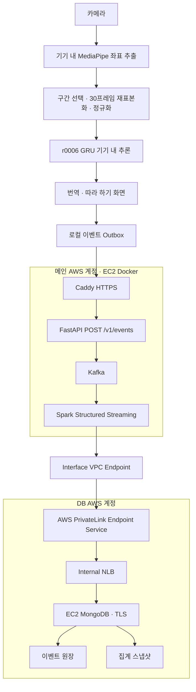
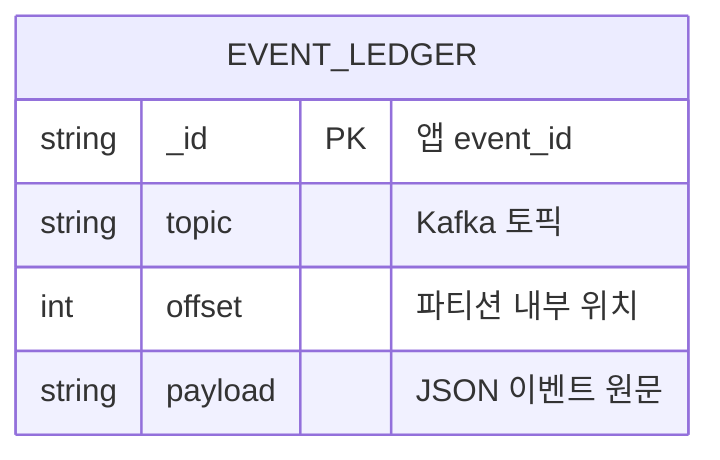
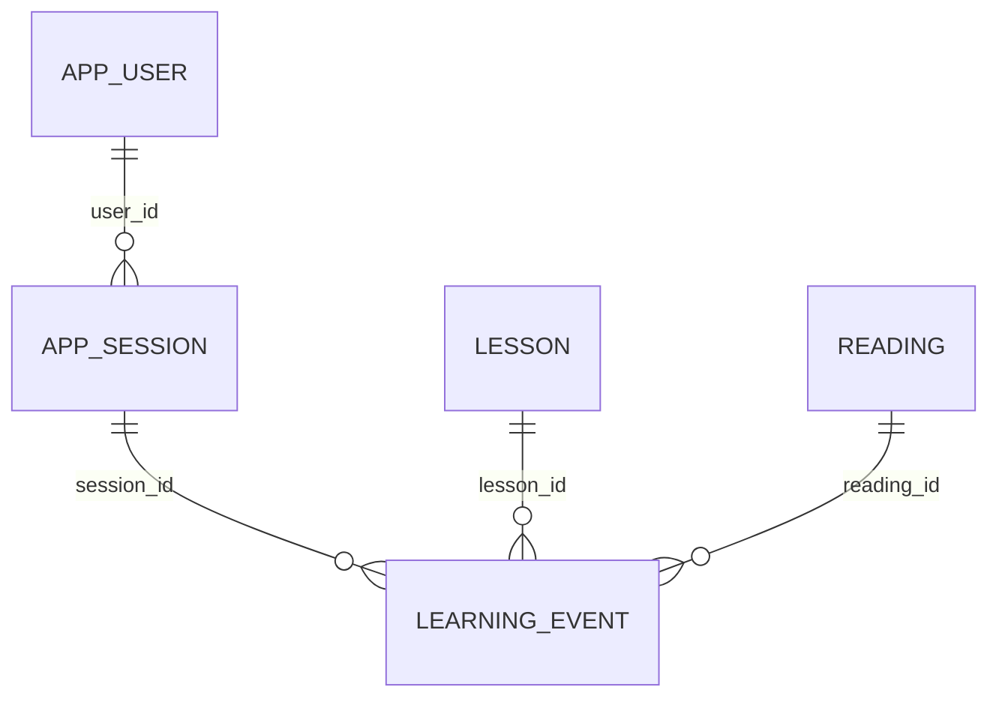

# 수어 칠판 · KSL Board

### 수어 학습 앱을 위한 실시간 로그 통합 파이프라인

카메라로 수어 단어를 읽고, 본보기 동작을 따라 연습하며, 학습 기록을 AWS에 수집하는 모바일 팀 프로젝트입니다. iOS와 Android에서 동작 좌표를 추출하고 기기에서 단어를 판정합니다. 서버는 학습 이벤트를 Kafka와 Spark로 처리해 MongoDB 원장과 통계로 보관합니다.

**1차 기술 문서 · 팀 구현·검증 중심 v5 · 2026-11-25 · 개발 및 내부 시험 단계**

과제의 중심은 앱에서 발생하는 학습 로그를 수집해 이벤트 ID로 추적하고, 시간 구간별 통계로 연결하는 데이터 파이프라인입니다. 교육 화면 하나와 커피·춥다·우유·감사·자다의 제한된 어휘를 대상으로, 모바일 기능과 수집·처리·저장·검증을 함께 설명합니다.

| 구성 | 구현 내용 |
|---|---|
| iOS | SwiftUI 화면, MediaPipe 좌표 추출, Core ML 추론, SceneKit 본보기, 이벤트 재전송 |
| Android | Expo·React Native 앱, WebView 내부 MediaPipe·JavaScript GRU 추론, 이벤트 재전송 |
| 서버 | Caddy HTTPS, FastAPI 이벤트 배치 API, Kafka, Spark Structured Streaming |
| DB·네트워크 | 별도 AWS 계정의 EC2 MongoDB, PrivateLink, TLS 인증, 이벤트 원장·집계 저장 |
| 실제 연동 | 아이폰·안드로이드 학습 기록의 MongoDB 도착과 아이폰 2대 동시 사용 시험 |

실제 서비스 적용과 측정 근거를 함께 기록합니다. 핵심 확인 결과는 두 아이폰의 이벤트 총 17건 저장, 최근 조회의 문서 검사 73→10, 제공 Android 기준 데이터의 전처리·확률 재검증 통과입니다. 자세한 조건은 [검증 결과](docs/verification.md)와 [측정 근거](evidence/README.md)에 있습니다.

## 목차

- [프로젝트 배경과 목표](#프로젝트-배경과-목표)
- [과제와 연결한 구현 내용](#과제와-연결한-구현-내용)
- [사용자 기능](#사용자-기능)
- [전체 아키텍처](#전체-아키텍처)
- [기술 스택과 선택](#기술-스택과-선택)
- [모델과 좌표 처리](#모델과-좌표-처리)
- [학습 이벤트 수집](#학습-이벤트-수집)
- [MongoDB 저장과 최적화](#mongodb-저장과-최적화)
- [데이터 모델과 ERD](#데이터-모델과-erd)
- [예외 처리와 운영 개선](#예외-처리와-운영-개선)
- [검증 결과](#검증-결과)
- [역할과 협업](#역할과-협업)
- [실행 및 문서](#실행-및-문서)
- [팀 수행 결과](#팀-수행-결과)

## 프로젝트 배경과 목표

처음 수어를 접하는 사용자가 본보기 동작을 보고 따라 하면서 인식 결과를 확인할 수 있는 앱을 만들었습니다. 모바일 추론과 함께 실제 학습 흐름을 기록하는 수집 경로를 구축해, 어떤 단어에서 시도와 실패가 발생하는지 확인할 기반을 마련했습니다.

1. 카메라 입력에서 손·상체 좌표를 추출하고 5개 목표 단어와 기타 동작을 판정합니다.
2. 번역 화면에서 읽은 단어와 후보를 확인하고, 학습 화면에서 본보기를 따라 연습합니다.
3. 연결이 일시적으로 끊겨도 학습 기록을 기기에 보관하고 재전송합니다.
4. 앱 이벤트를 서버·Kafka·MongoDB에서 같은 ID로 추적하고, 집계의 근거를 원장에 남깁니다.

## 과제와 연결한 구현 내용

강사님이 제시한 ‘실시간 로그 통합 파이프라인’을 수어 인식·교육 앱의 실제 학습 기록에 적용했습니다. 다음 표는 팀이 진행한 작업과 그 근거를 연결합니다.

| 과제와 연결되는 영역 | 팀 구현·수행 내용 | 근거 |
|---|---|---|
| 실시간 이벤트 수집 | 학습 시작·연습 단어·인식 결과·재시도·완료를 배치 API로 받고 Kafka에 발행 | 앱 소스·서버 담당 보고·실제 이벤트 대조 |
| 토픽과 메시지 키 | 학습 이벤트 토픽 사용, user_id를 Kafka 키로 지정, 파티션·오프셋으로 메시지 추적 | 실제 Kafka 조회·서버 담당 보고 |
| 스트리밍 소비·집계 | Spark 상시 소비, 1분 단어별 연습 횟수·최근 5분 미인식 비율·사용자 확인 일치율 계산 | 서버 담당 보고 |
| 체크포인트·재처리 | 체크포인트 기반 소비, 누락 오프셋 4건을 별도 Spark 배치로 복구 | 서버 담당 보고의 총 28건 대조 |
| 재전송 원장 관리 | 동일 event_id 유지, MongoDB _id 고유 키로 개별 기록 관리 | 실제 원장 구조·서버 담당 보고·임시 컬렉션 시험 |
| 저장 조회 최적화 | topic·offset 복합 인덱스로 최근·범위 조회의 문서 검사량 감소 | 실제 AWS 실행 계획·원문 비교 |

학습 지표의 입력은 practice_attempt, recognition_result, answer_selected로 구분합니다. 세부 이벤트 정의는 [데이터 계약](docs/data-contract.md), 수행한 스트리밍 작업은 [수집·처리 문서](docs/streaming-semantics.md)에 정리했습니다.

## 사용자 기능

| 기능 | 동작 |
|---|---|
| 단어 읽기 | 동작 구간을 시작·종료해 판정된 단어와 신뢰도를 표시 |
| 판정 상세 | 후보 확률, 손 검출 상태, 동작 길이 확인 |
| 본보기 학습 | 커피·춥다·우유·감사·자다의 본보기를 보고 따라 하기 |
| 학습 진도 | 목표 단어 인식 결과에 따라 진행 상태 기록 |
| 사용자 확인 | 번역 결과를 확인하거나 다른 단어로 수정한 기록 수집 |
| 자동 동기화 | 기록을 먼저 로컬 큐에 넣고 서버 응답에 따라 삭제·재시도 |

iOS는 SceneKit 3D 본보기를 회전해 볼 수 있습니다. Android는 해당 본보기를 렌더링한 프레임을 재생하며, 회전 가능한 3D 장면은 iOS 구현 범위입니다. 카메라 화면 위에 사용자의 동작을 따라 그리던 실시간 사람 모형은 11월 24일에 두 앱에서 제거했습니다.

## 전체 아키텍처

그림은 실제 학습 이벤트의 적재 경로입니다. 카메라 영상은 기기에서 좌표 추출에 사용하고, 서버에는 학습 이벤트 JSON을 전송합니다.

## 기술 스택과 선택

| 영역 | 기술 | 적용 목적 |
|---|---|---|
| iOS | Swift, SwiftUI, AVFoundation, MediaPipe, Core ML, SceneKit | 카메라 처리, 단말 추론, 학습 UI·본보기 |
| Android | Expo, React Native, WebView, MediaPipe Tasks Vision, JavaScript | Android에서 같은 좌표 규격과 모델 계산 구현 |
| API | Python, FastAPI | 이벤트 종류별 입력 검증, 인증, 배치 수신 |
| HTTPS | Caddy, Let’s Encrypt | 모바일 요청의 전송 암호화 |
| 메시지 | Apache Kafka | 이벤트 버퍼링, 소비 위치 추적, 재처리 기반 |
| 스트림 처리 | Spark Structured Streaming | 이벤트 소비, 시간 창 집계, 체크포인트 |
| 저장 | MongoDB, PyMongo | 이벤트 ID 기반 원문 보관과 집계 조회 |
| AWS | EC2, Elastic IP, PrivateLink, Internal NLB | 실행 환경, 고정 관리 주소, 계정 간 사설 접속 |
| 실행 관리 | Docker, Docker Compose | API·메시지·스트림 작업의 실행 환경 관리 |

기술별 배포 구조와 판단은 [아키텍처 문서](docs/architecture.md)에 정리했습니다.

처음 보는 독자는 [데이터 흐름도](docs/data-flow.md)에서 앱 내부 처리, 서버 수락, MongoDB 적재, 오류 조사 순서를 볼 수 있습니다.

## 모델과 좌표 처리

| 항목 | 현재 구현 |
|---|---|
| 모델 | `r0006`, GRU 기반 단어 분류 |
| 출력 순서 | 기타 → 커피 → 춥다 → 우유 → 감사 → 자다 |
| 프레임 규격 | 양손 21점씩 + 상체 17점 = 59점, 각 점의 x·y·z로 177개 값 |
| 입력 | 선택한 동작을 30프레임으로 재표본화한 `30 × 177` |
| 전처리 | 화면 비율 반영, 어깨 중심·너비 기준 정규화, 미검출 입력 처리 |
| 구간 | 약 0.5~3초, 번역 버튼 방식과 따라 하기 자동 구간 처리 |
| iOS 추론 | Core ML 모델 |
| Android 추론 | 변환한 가중치를 사용하는 JavaScript GRU 계산 |
| 표시 기준 | 제공 코드의 확신 표시 임시 기준 `0.6`, 동작 손 미검출 비율 기준 `0.5` |

표의 확률 기준은 제공 앱 코드에서 사용하는 표시용 기준입니다. 모델 확률과 실측 정확도는 구분합니다.

좌우를 뒤집은 좌표도 판정하는 보완 로직이 포함돼 있습니다.

### 전처리 이식과 기준값 검사

30프레임 재표본화는 구간의 프레임 인덱스를 균등 선택하는 방식입니다. 화면 비율로 x·z 단위를 맞추고 어깨 중심·너비로 정규화합니다. 어깨 미검출은 같은 시퀀스의 유효 평균으로 처리하고 손 z에는 손목 기준 좌표라는 예외를 적용합니다.

제공 Android ZIP의 엔진·모델·기준 데이터 1건을 2026-11-25 다시 계산했습니다. 전처리 최대 절대 오차는 **2.384×10⁻⁷**, 확률 최대 절대 오차는 **7.645×10⁻⁸**로 제공 테스트의 허용 기준을 통과했고, 기대 단어 ‘감사’도 일치했습니다. 이 수치는 제공 단일 기준 입력의 계산 일치 결과입니다.

[전처리 수식·좌우 선택·엔진 계산](docs/app-engine.md) · [재검증 결과 JSON](evidence/android-engine-reference.json)

## 학습 이벤트 수집

앱은 재전송에서도 같은 `event_id`를 유지합니다. API는 최대 100건의 이벤트 배치를 검증하고 Kafka 발행 성공을 확인한 뒤 HTTP `202`를 반환합니다. `202`는 Kafka 발행 확인 시점의 수락을 뜻하며, MongoDB 적재는 뒤따르는 비동기 작업에서 확인합니다.

| 기록 | 용도 |
|---|---|
| `lesson_started` | 학습 시작 |
| `practice_attempt` | 연습 시도 |
| `recognition_result` | 단어 판정·미인식 결과 |
| `retry` | 실패 후 재시도 |
| `lesson_completed` | 목표 학습 완료 |
| `lesson_ended` | 학습 종료 |
| `answer_selected` | 사용자의 번역 결과 확인·수정 |

서버는 `event_time`, `sent_at`, `received_at`을 보존합니다. 폰에서 발생한 시각과 실제 수신 시각을 구분해 오프라인 기록의 재전송을 추적합니다. Kafka 메시지 키는 `user_id`, DB 원장 문서 키는 `event_id`입니다.

[이벤트 계약과 저장 구조](docs/data-contract.md)

## MongoDB 저장과 최적화

실제 이벤트 원장 `learning_attempt_test_app_events`의 구조는 다음과 같습니다.

| 필드 | 자료형 | 역할 |
|---|---|---|
| `_id` | 문자열 | 이벤트 ID, 문서 중복 방지 기준 |
| `topic` | 문자열 | Kafka 토픽 |
| `offset` | 정수 | Kafka 처리 위치 |
| `payload` | 문자열 | JSON 형식의 이벤트 원문과 수신 메타데이터 |

`payload`는 문자열이므로 내부의 사용자·기기 값을 조회하려면 JSON 해석이 필요합니다. 원장과 집계 스냅샷은 별도 컬렉션으로 관리합니다. 아래 물리 저장 구조와 인덱스 비교는 직접 조회한 이벤트 원장을 기준으로 합니다.

최근 기록 조회에 `topic_offset_desc` 복합 인덱스 `{ topic: 1, offset: -1 }`를 적용했습니다. 원장 73건에서 최근 10건을 조회한 실행 계획이 전체 스캔·별도 정렬에서 인덱스 탐색으로 바뀌었습니다.

| 비교 | 적용 전 | 적용 후 |
|---|---|---|
| 문서 검사 | 73건 | 10건 |
| 반환 | 10건 | 10건 |
| 별도 정렬 단계 | 있음 | 없음 |
| 반환 원문·순서 대조 | 기준 | 일치 |

문서 검사량은 약 86.3% 감소했습니다. 당시 실행 시간은 0~1ms로, 지연 시간 개선률을 산정하기에는 데이터와 반복 측정이 충분하지 않습니다.

## 데이터 모델과 ERD

현재 물리 저장은 MongoDB 이벤트 원장 문서이며, 내부 이벤트 필드는 payload JSON 문자열에 들어 있습니다. 아래는 실제 확인한 최상위 필드입니다.

앱에서 사용자·세션·학습·인식이 이어지는 관계는 다음과 같습니다. 아래 노드는 논리적 개념이며, 사용자·학습 전용 컬렉션과 외래 키를 구현했다는 의미는 아닙니다.

집계는 여러 원장 이벤트에서 계산합니다. 원장 구조와 이벤트 간 연결은 [데이터 모델 문서](docs/data-model.md)에 정리했습니다.

## 예외 처리와 운영 개선

| 문제 | 구현·조치 | 근거 |
|---|---|---|
| 오프라인·일시 통신 실패 | 로컬 선저장, event_id 유지, 2초부터 최대 30초까지 지수 백오프 | iOS 코드 확인, 실제 재송신 적재 관측 |
| 배치 안 일부 입력 오류 | 거절 배치를 개별 전송해 정상 이벤트를 수락하고 오류 이벤트를 분리 | iOS Outbox 코드 확인 |
| 잘못된 API 입력·인증 | 종류별 필드·최대 100건·본문 1MB·X-API-Key 검증 | 서버 보고, 400·401 관측 |
| 응답 유실 후 같은 기록 재전송 | event_id를 MongoDB _id로 사용 | 실제 저장 구조, 중복 방지 서버 보고 |
| 누락된 이벤트 | 특정 Kafka 오프셋을 별도 배치로 재처리 | 서버 보고의 4건 복구·총 28건 대조 |
| 최근 조회 전체 스캔 | topic·offset 복합 인덱스 적용 | 실제 AWS 문서 검사 73→10 |
| DB 입력 예외 | 재시도·고유 키 오류·스키마 검증 | 임시 컬렉션 합성 시험 |
| 서버 재시작·주소 변경 | 컨테이너 재시작 정책, 체크포인트, Elastic IP | 서버 보고와 DB 관리 주소 확인 |

적용한 처리의 목적과 검증 조건을 [예외 처리·최적화 상세](docs/reliability-and-optimization.md)에 정리했습니다.

### 수신·저장의 책임 경계

- iOS는 파일 선저장, 동시에 여러 flush가 실행되지 않도록 하는 상태 가드, 원자적 파일 쓰기를 사용합니다.
- 일시 통신 실패는 2초부터 최대 30초까지 대기하며 같은 ID로 다시 보냅니다. 400·413·422는 거절 상태로 관리하고 배치를 개별 요청으로 분리합니다.
- API 수락은 Kafka 발행 확인 시점입니다. 응답 유실로 이미 발행된 이벤트가 다시 도착할 수 있습니다.
- 원장에는 event_id를 _id로 저장하고, Spark는 체크포인트를 사용해 소비 위치를 관리합니다.
- 전송 이력의 event_id·HTTP 응답을 Kafka 위치와 DB 원문에 연결해 실패 구간을 좁힙니다.

각 선택의 효과와 비용은 [설계 결정](docs/design-decisions.md), 실제 장애 조사 순서는 [운영 절차](docs/operations.md)에 정리했습니다.

## 검증 결과

| 검증 | 결과 | 근거 범위 |
|---|---|---|
| 실제 아이폰 이벤트 | 전달받은 이벤트 ID·오프셋 11건 일치, 이후 13건 추가 대조 일치 | DB 담당 직접 조회 |
| 아이폰 2대 동시 사용 | 시작 요청 수신 시각 차이 0.223초, 두 사용자·세션의 기록 총 17건 저장 | DB 담당 직접 조회 |
| Android 연동 | 오프셋 570~576의 이벤트 7건 저장, `device=android-16` 확인 | DB 담당 직접 조회 |
| 재전송 관찰 | 11월 25일 기록 9건이 09:13:01에 수신돼 원장에 저장, 이후 8건 추가 저장 | DB 담당 직접 조회 |
| 원장 조회 최적화 | 문서 검사 73→10, 반환 문서 BSON 해시·순서 일치 | DB 담당 실행 계획·문서 비교 |
| 재시도·잘못된 입력 | 임시 컬렉션에서 재전송 한 건 유지, 원본 보존, 오류 11000·121 확인 | DB 담당의 별도 합성 시험 |
| 누락 재처리 | 누락 4건 재처리 후 기존 24건 포함 총 28건 대조 일치 | 서버 담당 제공 보고 |
| 상시 Spark 저장 | 오프셋 504~560의 아이폰 이벤트 57건이 MongoDB에 자동 저장됐고, 이벤트 ID·오프셋·원문이 일치 | 서버 담당 제공 보고 |
| Android 기준 계산 재검증 | 전처리 5,310값·6확률의 최대 오차 허용 범위 통과 | 제공 코드·단일 fixture 직접 실행 |

위 검증 집합은 일부 겹칩니다. 합산해 전체 적재 건수로 사용하지 않습니다. 두 대 동시 시험은 해당 시나리오의 저장 성공을 검증한 결과입니다.

[검증 방법·수치·한계](docs/verification.md)

## 역할과 협업

| 역할 | 기여 |
|---|---|
| 앱·추론 담당 | iOS·Android 앱, 좌표 전처리와 r0006 추론 연동, 학습 UI·본보기, Outbox·재전송, 이벤트 규격 |
| 메인 서버 담당 | EC2·Docker, Caddy HTTPS, FastAPI 입력 검증, Kafka·Spark 상시 작업, 집계·재처리·재시작 운영 |
| DB·계정 간 연결 담당 | EC2 MongoDB, PrivateLink 제공 경로, TLS·인증 접속 검증, 원장 직접 대조, 조회 인덱스, DB 예외 시험·인수인계 |

역할별 기여는 제공 앱 소스·서버 보고·DB 수행 결과에 근거해 정리했습니다.

협업에서는 앱의 `event_id`를 공통 추적 키로 정하고, HTTP 응답 → Kafka 파티션·오프셋 → MongoDB 문서의 순서로 확인했습니다.

## 실행 및 문서

이 패키지는 팀이 구현·수행한 내용을 정리한 설명 문서와 측정 근거로 구성됩니다.

| 문서 | 내용 |
|---|---|
| [강사 요구사항 대응](docs/instructor-requirements.md) | 강사 과제와 연결되는 실제 팀 수행 내용 |
| [스트리밍 처리 명세](docs/streaming-semantics.md) | Kafka 토픽·키, Spark 소비·집계·체크포인트, 누락 재처리 |
| [아키텍처](docs/architecture.md) | 앱 추론·수집·계정 간 연결·설계 판단 |
| [앱 엔진](docs/app-engine.md) | 좌표 슬롯·전처리 수식·좌우 보완·기준값 재검증 |
| [앱 담당자 확인 결과](docs/app-status.md) | 최신 빌드·재전송 확인, 동의·수집 범위, 기기 값, 앱 묶음 정리, 보안 점검 |
| [데이터 계약](docs/data-contract.md) | 이벤트·시각·식별자·DB 필드 |
| [데이터 모델·ERD](docs/data-model.md) | 실제 저장 구조와 이벤트의 논리 관계 |
| [데이터 흐름도](docs/data-flow.md) | 앱 처리, 요청 수락, 적재, 오류 조사 시각화 |
| [예외 처리·최적화](docs/reliability-and-optimization.md) | 코드별 예외 분기, 재시도, 재처리, 실행 계획 개선 |
| [설계 결정](docs/design-decisions.md) | 선택한 구조의 효과·비용·검증 경계 |
| [운영 절차](docs/operations.md) | 수신·발행·소비·저장의 조사 순서와 단건 조회 |
| [측정 근거](evidence/README.md) | DB 실행 결과와 Android 기준 계산 결과 |
| [검증 결과](docs/verification.md) | 실제 시험, 제공 보고, 실행 계획과 한계 |
| [발표 진행안](docs/presentation.md) | 팀 발표 흐름·시연 순서·예상 질문 |
| [게시 검토](docs/release-review.md) | 파일·권리·설정 정리와 근거 목록 |

iOS는 제공 소스의 `ios-board/KSLBoard.xcworkspace`를 macOS·Xcode에서 엽니다. 의존성 재구성은 XcodeGen·CocoaPods를 사용합니다. Android는 제공 소스의 `expo-board`에서 `npm install`, `npm run engine`, `npm test`를 사용하며, 실행 방식에 따라 Expo Go 또는 APK 빌드를 선택합니다. 모델·본보기 자원의 공개 범위는 [게시 검토](docs/release-review.md)에 정리했습니다. 모바일 빌드를 새로 실행한 결과와 문서 작성 중 수행한 순수 엔진 계산 재검증은 구분합니다.

## 팀 수행 결과

- iOS·Android 앱과 실제 모바일 학습 이벤트의 AWS MongoDB 적재 확인
- HTTPS API → Kafka → 상시 Spark → PrivateLink → MongoDB 연결
- 학습 지표 계산과 체크포인트 운영에 대한 서버 구현 보고 통합
- 이벤트 ID·Kafka 오프셋·원문 대조와 두 아이폰 동시 사용 시험
- 누락 오프셋의 Spark 배치 재처리 및 원장 대조
- 실제 MongoDB 복합 인덱스 적용, 원문 보존 확인, 임시 컬렉션 예외 시험
- 메인·DB EC2 탄력적 IP 적용과 팀 인수인계
