# 앱 화면과 학습 이벤트 예시

## 자료 범위

iPhone 앱 담당자 제공 화면·기술 설명·전송 기록의 편집본. UI 이미지는 Mac에서 앱 코드로 렌더링한 화면 예시이며 실제 기기 스크린샷 또는 저장 성공 증빙으로 사용하지 않음. Android 화면의 동일성이나 같은 처리 성능을 의미하지 않음.

## 전체 화면

| 번역 · 처음 | 번역 · 읽는 중 |
|---|---|
| 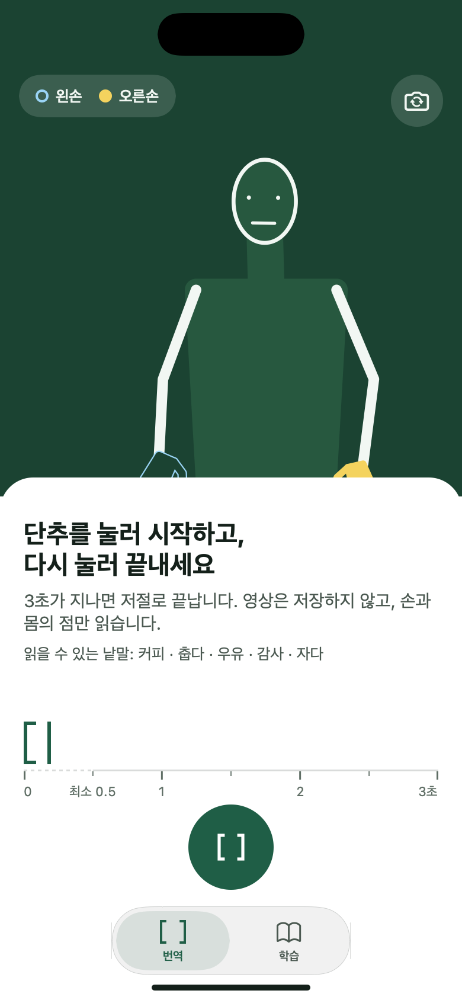 | 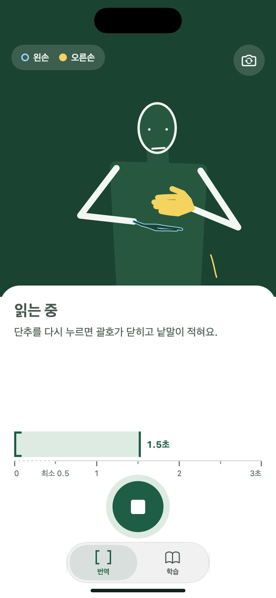 |

| 번역 · 읽음 | 번역 · 자세히 |
|---|---|
| 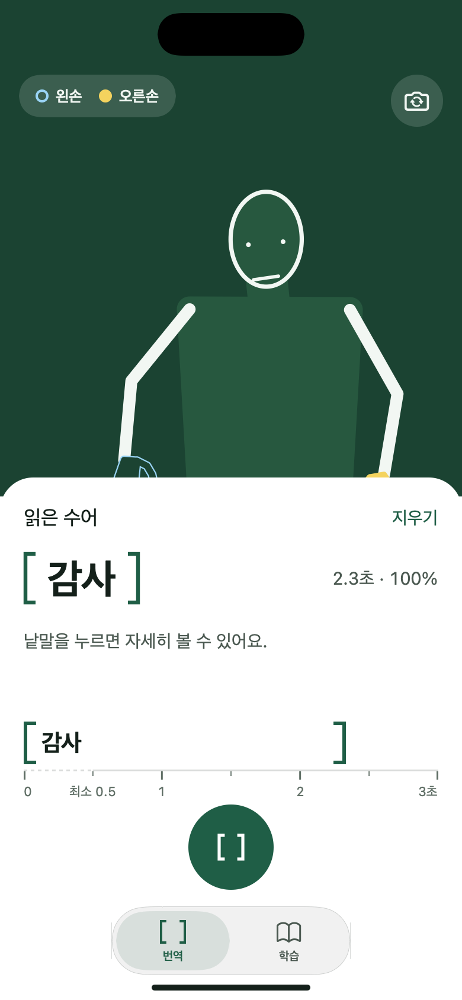 | 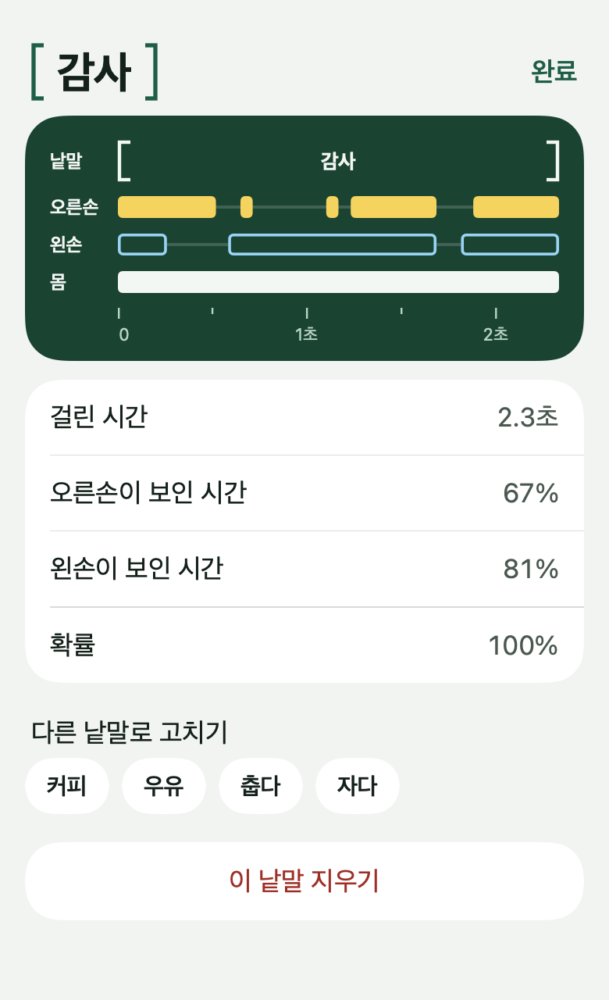 |

| 번역 · 확실하지 않음 | 학습 · 낱말 목록 |
|---|---|
| 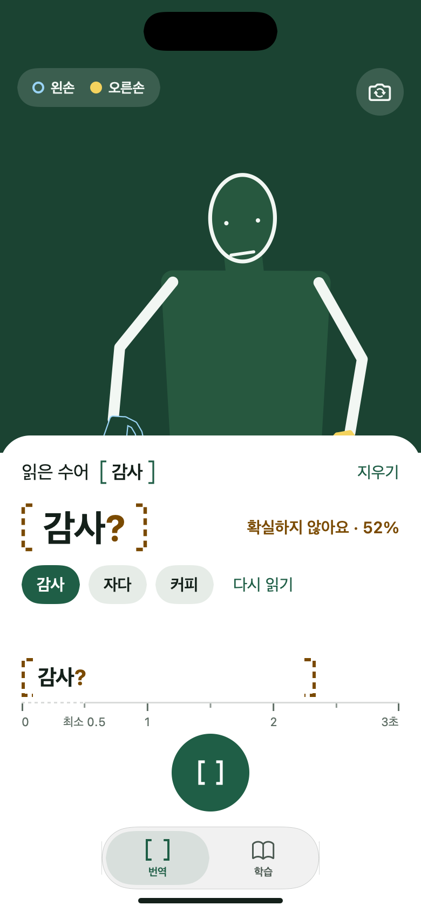 | 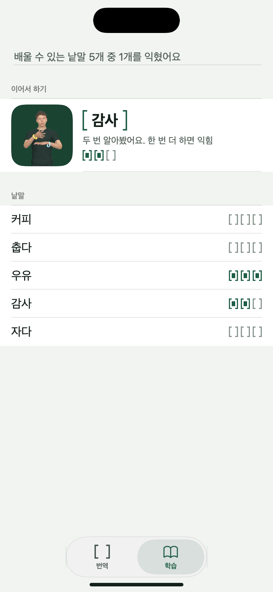 |

| 학습 · 본보기 | 따라 하기 · 준비 |
|---|---|
| 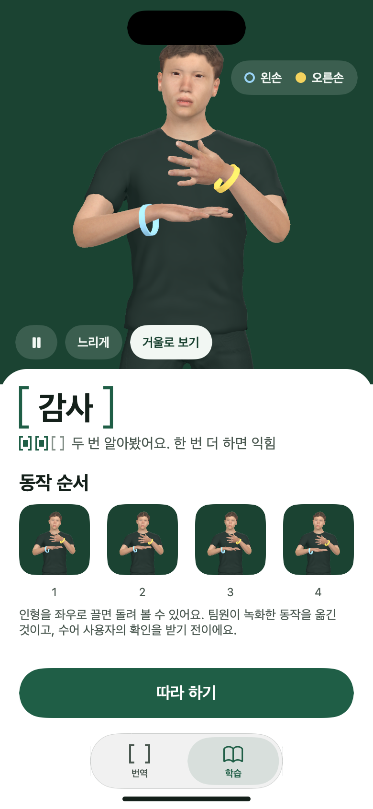 | 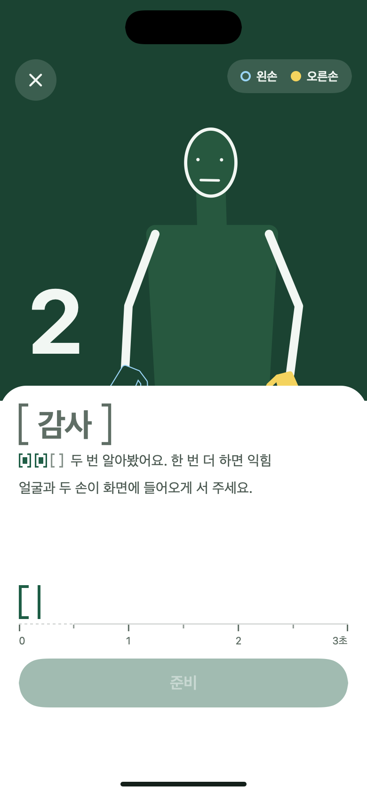 |

| 따라 하기 · 읽는 중 | 따라 하기 · 결과 |
|---|---|
| 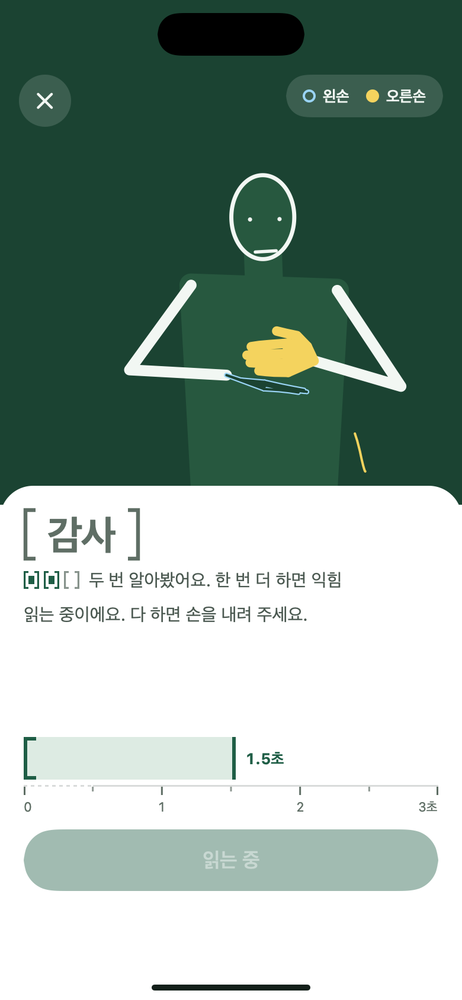 | 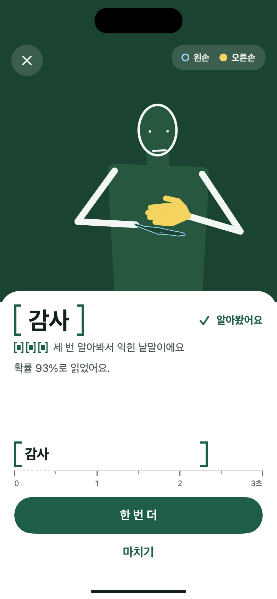 |

## 화면 조작과 이벤트 계약

| 조작·상태 | event_type | 구분 값·의미 |
|---|---|---|
| 본보기에서 따라 하기 진입 | `lesson_started` | `lesson_id`, `word` |
| 시작·한 번 더 | `practice_attempt` | `attempt` |
| 실패 후 다시 시작 | `retry` + `practice_attempt` | `previous_outcome`, `attempt` |
| 번역 판정 | `recognition_result` | `read`, `unsure`, `too_short`, `unknown`, `hands_unseen` |
| 학습 판정 | `recognition_result` | `correct`, `wrong_word`, `unsure`, `unknown`, `hands_unseen`, `no_hands` |
| 누적 세 번째 성공 | `lesson_completed` | `total_attempts`, `success_count` |
| 학습 화면 닫기·마치기 | `lesson_ended` | 시도·성공 집계 |
| 번역 후보 확인·수정 | `answer_selected` | `selected_word`, `was_corrected` |

`confirmed`·`corrected`는 화면 설명용 표현. 실제 전송 필드는 `was_corrected=false/true`. 모든 화면 전환을 이벤트로 세지 않으며, `retry`와 함께 발생한 `practice_attempt`를 별도 연습 두 번으로 계산하지 않도록 이벤트 유형별 집계 구분.

## 단말 처리와 서버 접수의 경계

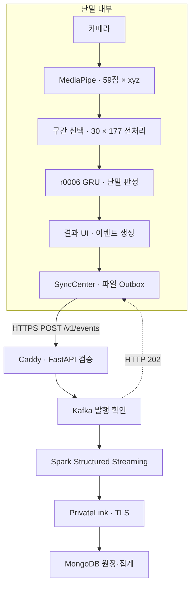

카메라 영상은 단말 내부에서 처리. 이 이벤트 흐름은 좌표 샘플 업로드와 별도 경로. 최신 앱 설명의 확신 기준은 0.6이며, 초기 실험의 임시 기준 0.85와 구분. 모델 정확도 60%라는 의미가 아니라 개별 출력 확률의 판정 기준.

## 실제 전송 기록 발췌

아래 값은 앱 담당자가 제공한 iPhone 18 Pro Max 전송 기록 요약. 이 편집 작업에서 기기·서버를 새로 측정한 결과가 아님. 시각은 첫 이벤트 기준 상대 시간으로 표현.

| seq | event_type | outcome | 상대 생성 시각 | HTTP 202까지 |
|---|---|---|---:|---:|
| 173 | lesson_started | — | 0.00초 | 1.54초 |
| 174 | practice_attempt | — | +2.64초 | 1.54초 |
| 175 | recognition_result | unknown | +8.54초 | 1.55초 |
| 176 | retry | — | +10.62초 | 1.54초 |
| 177 | practice_attempt | — | +10.62초 | 1.54초 |
| 178 | recognition_result | correct | +16.68초 | 1.59초 |
| 179 | lesson_completed | — | +16.68초 | 1.58초 |
| 180 | lesson_ended | — | +19.95초 | 1.53초 |

8건은 이벤트 수이며 HTTP 요청 8회를 의미하지 않음. 동시에 생성한 이벤트는 같은 배치로 전송 가능. 발췌 이전의 성공 이력은 이 표에 포함되지 않으므로 한 번의 성공으로 완료했다고 해석하지 않음.

- 생성→접수 응답: 1.53~1.59초, 관측 표본 8건.
- 배치 대기: 1.5초 설정. 관측값에서 설정값을 뺀 0.03~0.09초는 추정 잔여이며 RTT 실측으로 사용하지 않음.
- 시작→판정: 8.54−2.64=5.90초, 16.68−10.62=6.06초. 준비 카운트다운 2.7초·사용자 동작 포함. 순수 모델 추론 지연과 구분.
- Kafka→Spark→MongoDB 저장 완료 지연: 해당 자료에는 측정값 없음.

## 재전송·입력 예외 처리

| 상황 | 앱 동작 |
|---|---|
| 연결 실패·응답 없음 | Outbox 유지, 2→4→8→16→30초 재시도 간격 |
| 내용·크기 오류 400·413·422 | 별도 격리 후 하루 한 번 재대기 |
| 인증·주소 오류 401·403·404 | 삭제하지 않고 보관·재시도 |
| 정상 수락 | 성공 응답에 따라 해당 Outbox 기록 제거 |
| 대기 한도 5,000건 초과 | 오래된 기록부터 제거하는 유한 보관 정책 |

한도 초과 시 제거 정책이 있으므로 무제한 보관·절대 무손실로 표현하지 않음. 상세 설명에는 정상 2xx 처리와 202 응답 사례가 함께 있으므로 모든 경로가 오직 202에서만 삭제된다고 일반화하지 않음.

## 제공 원본 흐름도

[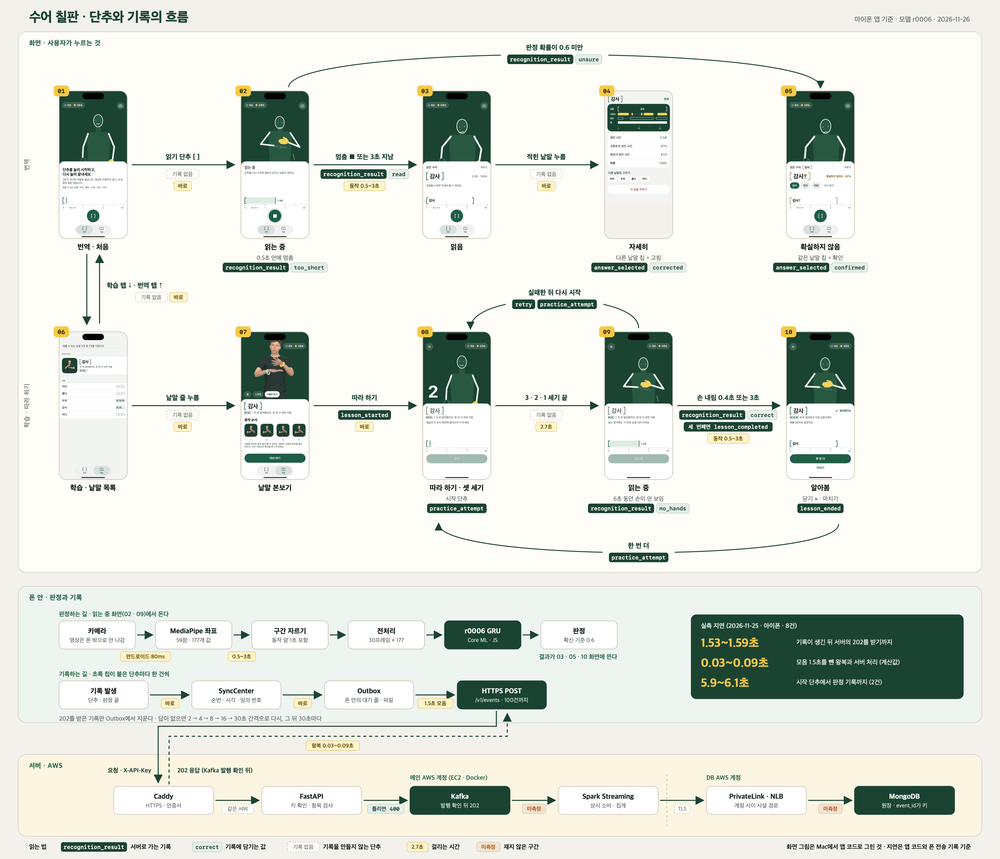](../assets/app-demo/screen-event-overview.png)

원본 도식은 날짜·측정 범위·설명용 표기를 포함한 참고 자료. `corrected/confirmed` 등의 그림 표기는 위 이벤트 계약 표와 함께 해석. 큰 도식의 세부 내용은 이미지 클릭 후 확대 확인.
