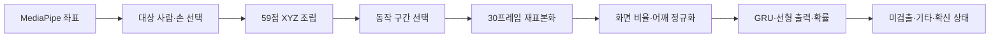

# 모바일 인식 엔진

## 입력부터 판정까지



| 구현 위치 | 역할 |
|---|---|
| iOS Core/SignSpec.swift | 좌표 슬롯·길이·대상 FPS 상수 |
| iOS Core/FrameBuilder.swift | 대상 사람·손 선택, 177값 조립 |
| iOS Core/Segmenter.swift | 버튼·자동 구간, 길이·프레임 예외 |
| iOS Core/Preprocess.swift | 재표본화·정규화·미검출 변환 |
| iOS Core/SignClassifier.swift | Core ML 모델 실행 |
| iOS Engine/HandMirror.swift | 좌우 반전 좌표 생성 |
| iOS Engine/Reading.swift | 확률·미검출을 UI 상태로 변환 |
| Android engine/core.js | 같은 규격의 JavaScript 엔진 |
| Android App.js | WebView와 네이티브 네트워크 통신 중계 |

iOS Core는 제공 ZIP의 `ios/KSLSign/Core`, Engine은 `ios-board/KSLBoard/Engine`을 뜻합니다.

## 좌표 슬롯과 구간

| 슬롯 | 점 개수 | 설명 |
|---|---:|---|
| 0~20 | 21 | MediaPipe Right 라벨 |
| 21~41 | 21 | MediaPipe Left 라벨 |
| 42~58 | 17 | Pose 0~16 |
| 전체 | 59 | 각 점 XYZ, 총 177값 |

카메라 미러링과 MediaPipe 라벨, 화면에서 부르는 실제 손 이름을 구분합니다. 라벨 슬롯을 임의로 바꾸면 학습 규격과 달라질 수 있습니다. `targetFPS` 상수는 15이며 실기기 실측 FPS를 뜻하지 않습니다.

구간은 약 0.5~3초입니다. 자동 구간은 손 검출을 확인하며 시작·종료를 제어하고, 버튼 방식은 사용자가 구간을 지정합니다. 구간 안 2프레임 미만은 판정 전에 거절합니다.

## 재표본화와 정규화

### 길이 통일

구간의 프레임 수가 N일 때 출력 인덱스는 다음과 같이 선택합니다.

```text
i(k) = floor(k × (N - 1) / 29), k = 0 ... 29
i(29) = N - 1
```

기존 프레임 인덱스를 균등 선택합니다. 선택한 프레임이 반복될 수 있으며 선형 보간으로 새 좌표를 만드는 방식과 구분합니다.

### 화면 비율과 어깨 기준

화면 가로세로 비를 a라고 할 때 x·z를 a배해 단위를 맞춥니다. 각 프레임의 좌우 어깨로 중심과 너비를 계산합니다.

```text
x_scaled = a × x
z_scaled = a × z
center = (left_shoulder + right_shoulder) / 2
width = sqrt(dx² + dy²)
normalized = (scaled_coordinate - center) / width
```

손의 z는 손목 기준이므로 어깨 z 중심을 빼지 않는 예외가 있습니다. 어깨 너비가 유효하지 않은 프레임은 같은 시퀀스의 유효 평균을 사용합니다. 유효 어깨가 전혀 없으면 중심 0·너비 1을 사용합니다. 최종 NaN은 0, 무한대는 float32 유한 범위로 변환합니다.

이는 계산 가능한 입력을 만드는 처리입니다. 부족한 관측을 실제 좌표로 복원한 것으로 해석하지 않으며 손 미검출 비율을 별도 품질 신호로 사용합니다.

### 수치 이식

iOS는 float32 연산과 평균 계산·합산 순서를 기준 구현에 맞춥니다. Android는 Float32Array와 Math.fround 등을 사용합니다. 두 구현의 계산 차이가 있을 수 있어 기준 데이터로 전처리·출력 확률을 비교합니다.

## 판정과 좌우 보완

Android 엔진은 GRU의 reset·update·candidate 계산, 마지막 은닉 상태의 선형 출력, softmax를 구현합니다. softmax는 최대 logit을 먼저 빼고 지수화합니다. 출력 라벨 순서는 기타·커피·춥다·우유·감사·자다입니다.

원본과 좌우 반전 좌표를 각각 추론합니다. 반전은 x를 `1-x`로 바꾸고 양손 슬롯과 좌우 Pose 쌍을 교환합니다. 기타를 제외한 목표 단어 중 최고 확률이 큰 결과를 선택합니다.

| 우선순위 | 조건 | 표시 상태 |
|---|---|---|
| 1 | 동작 손 미검출 비율 > 0.5 | hands_unseen |
| 2 | 최고 라벨이 기타 | unknown |
| 3 | 최고 확률 >= 0.6 | 확신 표시 |
| 4 | 최고 확률 < 0.6 | unsure |

0.6은 제공 코드의 임시 표시 기준입니다. 초기 설계의 0.85가 현재 코드에 적용된 것으로 설명하지 않습니다. 좌우 보완은 기타 오검출 가능성도 바꿀 수 있어 관련 영향은 추가 평가 범위입니다.

## 제공 자료를 이용한 재검증

2026-11-25 제공 Android ZIP의 `core.js`, `model.json`, `fixture.json`을 읽어 Node.js의 제한된 VM 컨텍스트에서 계산했습니다. 모델·좌표 원본은 게시 묶음에 포함하지 않고 파일 해시와 결과를 남겼습니다.

| 검사 | 허용 기준 | 측정 결과 |
|---|---:|---:|
| 전처리 값 수 | 30×177 | 5,310 |
| 전처리 최대 절대 오차 | < 1×10⁻⁵ | 2.384185791015625×10⁻⁷ |
| 확률 최대 절대 오차 | < 1×10⁻⁴ | 7.644642940896063×10⁻⁸ |
| 기대 판정 | 감사 | 감사 |

허용 기준은 제공 `tools/test_core.mjs`와 같습니다. 비교 대상은 ZIP에 포함된 기준값이며, Python 학습 모델·iOS 기기를 다시 실행한 결과는 아닙니다. 단일 fixture 통과를 모델 전체 정확도로 일반화하지 않습니다.

사용 허가를 받은 원본 Android 소스가 있으면 `expo-board`에서 제공 명령으로 재검증할 수 있습니다.

```bash
npm test
```

[파일 해시·환경·실행 결과](../evidence/android-engine-reference.json)

앱 담당자 README는 아이폰 샘플 8건의 판정 일치도 보고했습니다. 해당 샘플 폴더가 이번 자료에 포함되지 않아 이 8건은 제공 보고로 유지합니다.
