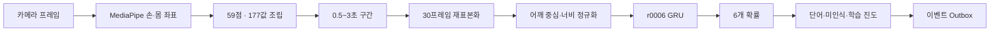
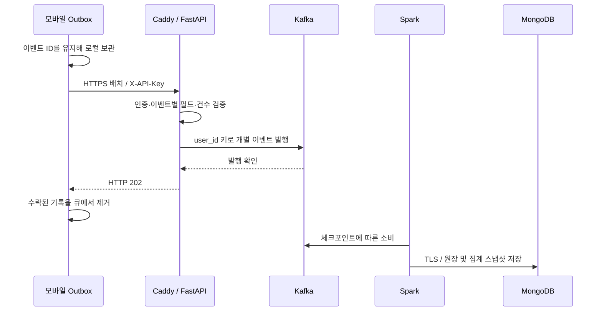

# 시스템 아키텍처와 설계 판단

기준일은 2026-11-25입니다. 앱 ZIP의 코드·문서, 메인 서버 담당자 제공 보고, DB 담당자의 실제 조회 결과를 통합했습니다.

## 앱 내부 처리

- iOS의 `Core`·`Capture`는 SwiftUI 화면 프로젝트에서 공통 엔진으로 참조합니다.
- iOS는 Core ML, Android는 WebView의 JavaScript GRU 계산을 사용합니다. 동일 입력의 전처리·확률을 기준값과 대조했습니다.
- Android README에 전처리 차이 `2.4e-7`, 확률 차이 `7.6e-8`, 아이폰 샘플 8건의 판정 일치가 보고돼 있습니다. 11월25일 제공 단일 fixture의 순수 엔진 계산을 재실행해 전처리·확률 허용 범위를 통과했습니다. 8건 실기기 샘플 일치는 제공 보고이며 [재검증 범위](app-engine.md)와 구분합니다.
- Android APK는 페이지·MediaPipe WASM·좌표 모델을 앱에 묶는 구성을 제공합니다. Expo Go와 웹 실행은 초기 좌표 모델 다운로드가 필요합니다.
- 영상의 기기 외부 전송을 생략하고 좌표로 추론합니다. 추론 결과와 학습 기록은 서버에 전송합니다.

## 앱에서 MongoDB까지

앱은 재전송에서도 같은 event_id를 유지하고, 원장에는 해당 ID를 _id로 저장합니다. Spark는 체크포인트로 소비 위치를 관리합니다.

Kafka 키는 사용자별 순서 유지를 위한 `user_id`입니다. Kafka 오프셋은 파티션 내부 위치이므로 일반적인 처리 식별에는 토픽·파티션·오프셋을 함께 사용합니다. 현재 직접 조회한 원장은 `_id`, `topic`, `offset`, `payload` 네 필드이며 `partition` 필드는 없었습니다.

## AWS 네트워크

| 영역 | 배포 구성 |
|---|---|
| 메인 EC2 | 서버 담당 보고 기준 Ubuntu 24.04, `t3.medium`, Docker·Compose |
| 메인 실행 단위 | Caddy, FastAPI, Kafka, Spark |
| DB EC2 | 별도 계정의 `t3.micro`, MongoDB 8.0.34 |
| 서버 간 경로 | 팀 Interface Endpoint → DB Endpoint Service → Internal NLB → MongoDB |
| DB 전송 보호 | TLS 필수, CA 검증, MongoDB 계정 인증 |
| 관리 접속 | SSH 키 인증, 현재 고정 관리 주소 사용 |
| 주소 안정화 | 메인·DB EC2 Elastic IP |

별도 계정의 두 VPC에서 동일한 `172.31.0.0/16` 대역을 사용한 구성이어서, 서비스 단위 PrivateLink로 연결했습니다. 실제 사설 주소의 동일 대역 여부는 계정별 구성의 근거를 기준으로 설명하며, 단순히 두 IP가 `172.31`로 시작한다는 이유만으로 같은 VPC라고 판단하지 않습니다.

DB는 `requireTLS`로 구성했고, 내부 로드밸런서의 대상 상태와 MongoDB 인증·`ping`을 단계별로 확인했습니다. 인증서 개인키와 DB 비밀번호는 서버 측에서 관리합니다.

퍼블릭 Elastic IP는 관리 접속과 앱 HTTPS 주소를 안정화합니다. 서버 간 MongoDB 연결은 PrivateLink DNS를 사용합니다. 계정·서버별 실제 주소는 배포 환경 설정에서 주입합니다.

## 설계 결정

| 결정 | 적용 이유 | 기술적 특성 |
|---|---|---|
| 기기 내 추론 | 단어 판정과 서버 통신 분리 | iOS Core ML·Android JavaScript GRU |
| Outbox | 통신 실패 시 기록 보관·재전송 | 로컬 파일·같은 event_id·지수 백오프 |
| Kafka | API 요청과 비동기 처리를 분리 | user_id 키·파티션별 오프셋 추적 |
| Spark | 상시 소비와 학습 통계 계산 | 체크포인트·시간 구간별 집계 |
| MongoDB 원문 저장 | 개별 기록 추적·원문 대조 | event_id 고유 키·payload JSON 문자열 |
| 복합 인덱스 | 최근 기록의 전체 스캔 개선 | topic 동등 조건·offset 내림차순 탐색 |

## 시간 구간별 학습 통계

서버 담당자 제공 보고에는 1분 단어별 연습 횟수, 최근 5분 미인식 비율, 사용자 확인 일치율 집계가 포함돼 있습니다. 통계의 원천 이벤트와 분모는 [데이터 계약](data-contract.md), 수집·소비·재처리는 [스트리밍 처리](streaming-semantics.md)에 정리했습니다.
