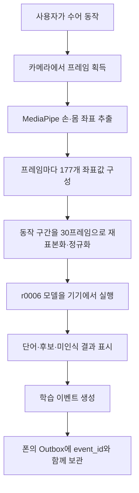
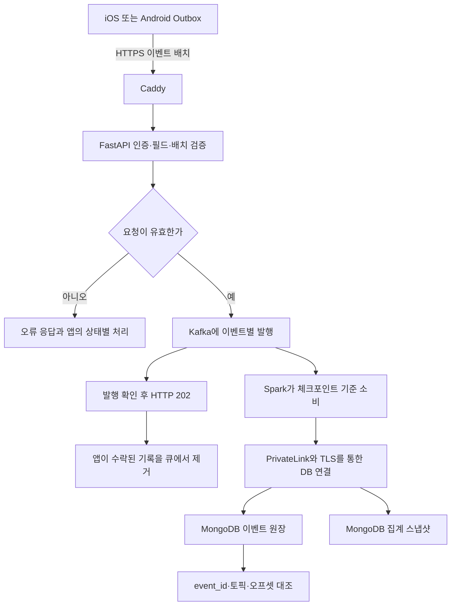
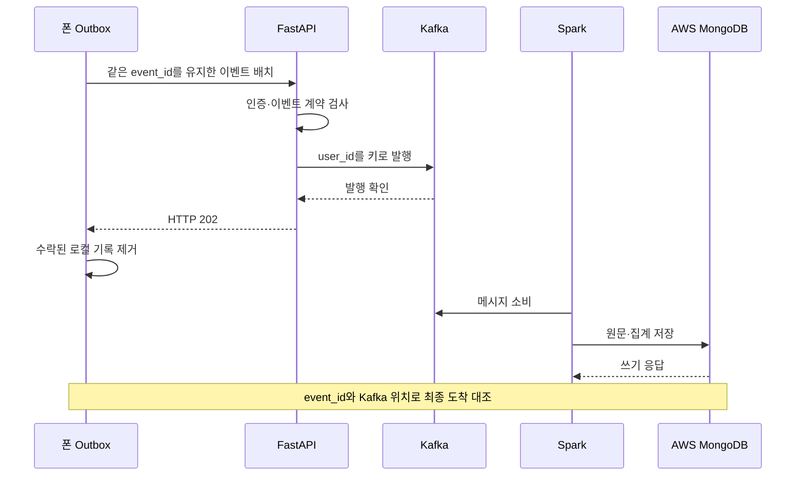
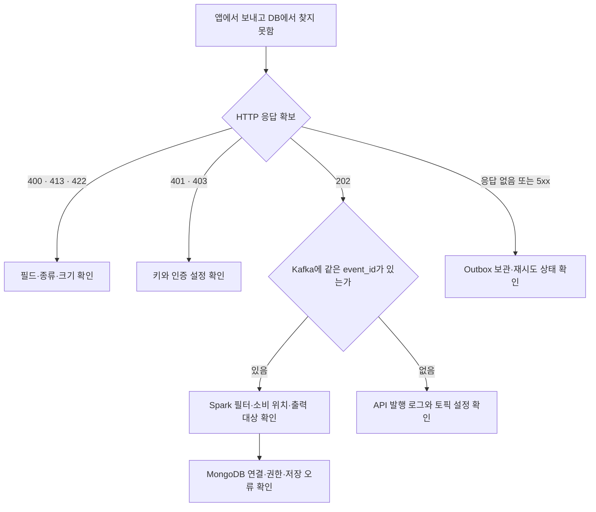
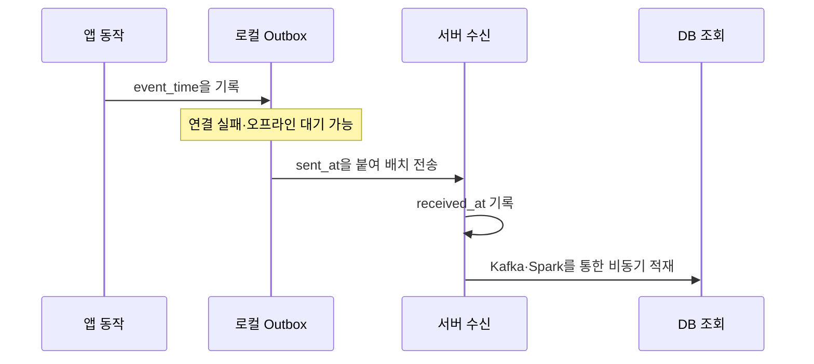

# 데이터 흐름과 오류 시 동작

앱의 사용자 동작이 이벤트로 생성되고 Kafka·Spark·MongoDB를 거쳐 추적되는 흐름을 정리합니다.

## 사용자의 동작이 기록이 되는 과정

화면을 열고 학습을 시작하는 행위도 이벤트를 만듭니다. 위 그림의 인식 결과 외에 학습 시작·시도·종료 이벤트가 별도로 존재합니다. 영상은 기기 내 좌표 추출에 사용하고, 서버에는 이벤트 JSON을 전송합니다.

## 실제 적재 경로

원장은 개별 기록을, 집계 스냅샷은 학습 통계를 저장하는 출력입니다. event_id와 원문을 기준으로 이벤트의 도착을 대조했습니다.

## 요청 수락과 DB 적재의 시점

202는 Kafka 발행 수락 시점입니다. DB에서 ID를 조회해 저장 완료를 확인합니다. 사용자가 보내는 실제 샘플 ID나 이벤트 ID는 공개 설명에서는 합성 값으로 대체합니다.

## 장애를 조사하는 순서

실제로 202와 Kafka 적재가 확인돼도 시험 세션 필터와 SQLite 출력 때문에 기존 MongoDB 원장에 기록이 없었던 사례가 있었습니다. 각 단계의 상태를 확인해 실제 앱 세션을 받는 MongoDB 상시 저장 경로로 연결했습니다.

## 재전송 시 시간 해석

event_time은 앱 동작 시각, sent_at은 배치 전송 시각, received_at은 서버 수신 시각입니다. 오프라인 기록의 재전송 여부를 해석할 때 이 시각을 함께 대조했습니다.

