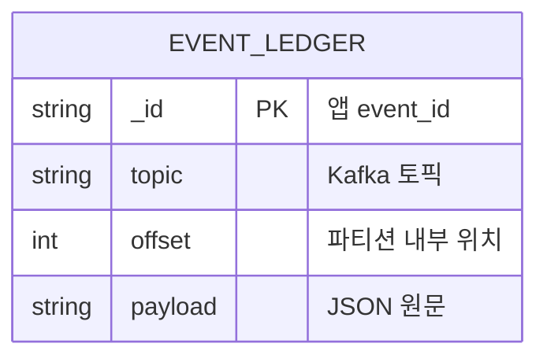
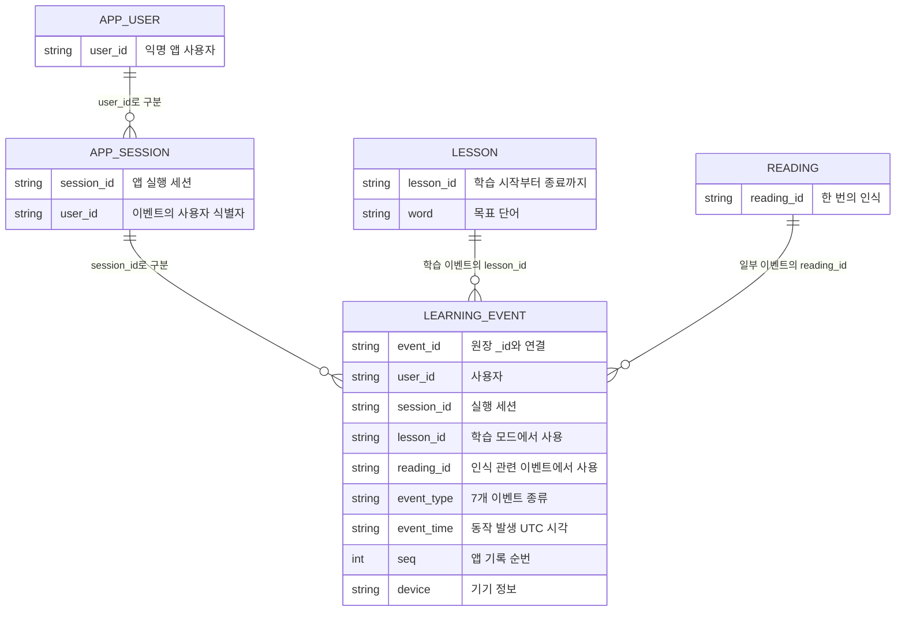
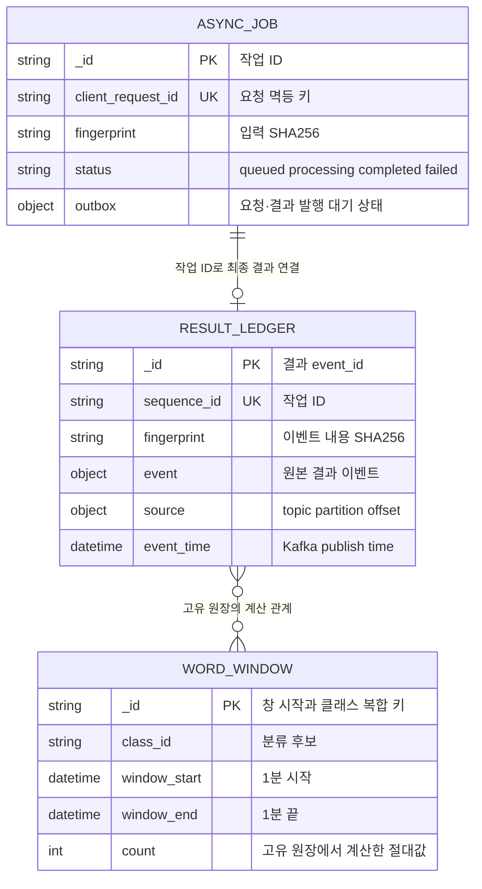

# 데이터 모델과 ERD

MongoDB는 문서 단위로 저장합니다. 먼저 실제 원장 구조를 표시하고, 이벤트 안의 식별자가 연결하는 논리적 관계를 별도 ERD로 설명합니다. ERD의 사용자·세션·학습·인식 노드는 앱 이벤트의 의미를 표현하며 실제 독립 컬렉션이나 외래 키 제약을 뜻하지 않습니다.

## 실제 원장 구조

컬렉션은 `ksl_demo_video_stream_stats_aws_v1.learning_attempt_test_app_events`입니다. 최상위 네 필드는 실제 조회로 확인했습니다. `_id`는 MongoDB의 실제 고유 키이고, 추가 인덱스는 `{ topic: 1, offset: -1 }`입니다. 파티션 정보는 Kafka 측 조회와 함께 대조했습니다.

payload는 문자열로 보존합니다. 아래 논리 필드는 JSON 해석 후 확인하며, `payload.user_id`에 바로 인덱스를 거는 형태는 현재 저장 구조와 다릅니다.

## 앱 이벤트의 논리적 관계

`lesson_started`·`practice_attempt`·`retry`·학습 종료 등은 lesson_id로 묶습니다. 번역의 `recognition_result`와 사용자 확인 `answer_selected`는 reading_id로 연결합니다. 동작이 너무 짧거나 손이 없는 경우 reading_id가 생략될 수 있습니다. 한 번의 인식과 여러 사용자 확인이 연결될 수 있어 논리 모델은 이벤트 수를 고정하지 않습니다.

## 집계 모델

서버 담당자는 원장과 집계 스냅샷을 별도 컬렉션에 저장한다고 보고했습니다. 위 물리 ERD는 직접 조회한 이벤트 원장의 구조를 표현합니다.

| 통계 | 논리적 그룹 기준 | 원천 |
|---|---|---|
| 단어별 시도 | 시간 창 + word | practice_attempt |
| 미인식 비율 | 시간 창 | recognition_result |
| 사용자 확인 일치율 | 합의한 집계 구간 | answer_selected |

이벤트와 통계는 event_id별 외래 키 관계보다, 집계 대상 이벤트를 선택하는 계산 관계로 연결됩니다. 표는 서버 보고와 앱 이벤트 규격에 근거한 계산 관계입니다.

## 처음 읽는 사람을 위한 용어

| 용어 | 의미 |
|---|---|
| 이벤트 | 학습 시작·시도·인식 결과처럼 앱에서 발생한 개별 기록 |
| 원장 | 개별 이벤트 원문을 보관하는 기준 기록 |
| 집계 스냅샷 | 여러 원장 이벤트로 계산한 통계의 저장 결과 |
| Kafka 오프셋 | 특정 파티션에서 메시지가 차지하는 위치 |
| 체크포인트 | Spark가 소비 위치·처리 상태를 이어가는 데 사용하는 저장 상태 |

## 영상 작업 실습의 데이터 관계

아래는 포함된 실습 코드의 작업·Outbox·결과·통계 관계입니다. 앞의 모바일 원장 네 필드와는 별도 저장 모델입니다. 화살표는 ID를 통한 논리적 연결이며 MongoDB의 외래 키 제약을 뜻하지 않습니다.

작업 문서와 Outbox를 함께 저장하고 결과 원장에는 sequence_id 고유 인덱스를 둡니다. 통계는 동일 이벤트의 반복 수신을 그대로 더하지 않고 원장으로부터 다시 계산해 갱신하는 코드입니다.

[실습 파이프라인과 복구 결과](prototype-pipeline.md)
