# MediaPipe 좌표 처리와 데이터 품질 관리

카메라·영상에서 좌표를 추출하는 것에 더해, 손 배정·결측 표현·구간 선택·정규화·길이 통일·학습 입력 검사를 단계별 코드로 구현했습니다. 실험 코드는 experiments, 실제 모바일 엔진은 mobile에 보관합니다.

## 데이터 준비부터 모델 입력까지

```mermaid
flowchart LR
    V[기준 영상·웹캠 녹화] --> D[손·상체 검출]
    D --> R[원시 좌표·검출 정보 보관]
    R --> H[프레임 간 손 배정]
    H --> X[59점 XYZ · 유효 마스크]
    X --> N[어깨 중심·너비 XY 정규화]
    N --> T[라벨 구간의 30프레임 선택]
    T --> F[XY 118값 + 마스크 59값]
    F --> Q[배열·라벨·그룹·해시 검사]
    Q --> K[kNN 학습·검증]
```



## 단계별 코드와 보존 정보

| 단계 | 코드 | 주요 처리 |
|---|---|---|
| 녹화 | record_webcam_clip.py | 실제 수집 시각으로 FPS 계산, 프레임 크기 검사, 임시 MP4 저장 |
| 원시 검출 확인 | review_raw_hands.py | 손 검출·프레임·분류 라벨을 원시 상태로 확인 |
| 손 배정 | track_hands_pilot.py, track_hands_v2_experiment.py | 검출 라벨과 이전 손목 위치를 이용한 슬롯 연결 |
| 좌표 조립 | build_mediapipe177_pilot.py | 손 42점+Pose 17점의 XYZ, 프레임·마스크·검출 ID 검사 |
| 정규화 | normalize_mediapipe177_pilot.py | 어깨 중심·거리로 XY 정규화, 가역 복원 오차 검사 |
| 시간 길이 통일 | resample_xy30_pilot.py | 연속된 라벨 구간에서 30개 프레임 인덱스 선택 |
| 배치 처리 | run_mediapipe_batch.py | 단계별 산출물·완료 기록·해시를 연결해 재사용 |
| 학습 데이터 구성 | prepare_mediapipe_baseline.py | 124개 시퀀스·기존 분할·라벨·품질·배열 대조 |

모든 파일은 [실습 코드](../experiments/03_실습코드/)에 있습니다.

## 손 배정과 결측 처리

원시 검출과 손 배정 결과의 프레임 번호·검출 ID를 대조하고, 한 검출이 여러 손 슬롯에 중복 배치되지 않도록 검사합니다. 미검출 좌표는 NaN과 별도 마스크로 보존합니다. 학습 입력을 만들 때는 마스크를 유지한 상태에서 좌표를 0으로 채웁니다.

v2 배정 실험은 손목 위치 연속성과 신뢰할 수 있는 단일 손 라벨을 함께 사용합니다. 기본 설정은 과거 트랙 유지 5프레임, 거리 한도 0.25, 후보 비용 차이 0.04, 라벨 점수 0.7입니다. 위치가 모호하거나 너무 멀면 강제로 배정하지 않는 분기를 구현했습니다. 배정된 검출 수와 원시 검출 수를 비교하는 보고서도 저장했습니다.

## 정규화와 프레임 선택

실험 정규화는 정규화 좌표를 영상 픽셀 XY로 변환한 뒤 어깨 중점 c와 어깨 거리 s를 사용합니다.

```text
normalized_xy = (pixel_xy - shoulder_center) / shoulder_width
```

어깨 visibility 0.5 이상, 어깨 거리 1픽셀 초과 등의 조건으로 정규화 가능 프레임을 구분합니다. 역변환 오차 0.02픽셀 기준을 검사하고, 원본 XYZ는 별도 파일로 유지합니다.

실험의 30프레임 선택은 np.rint(np.linspace(0, N-1, 30)) 방식입니다. 원본 프레임 인덱스와 시각을 함께 보관합니다. 모바일 엔진의 floor 기반 선택과는 각 코드의 전처리 버전으로 구분합니다.

## 같은 177값이라도 서로 다른 입력 계약

| 사용 위치 | 한 프레임의 구성 | 시간 길이 | 식별 기준 |
|---|---|---|---|
| MediaPipe 원시 조립 | 59점 × XYZ | 원본 프레임 수 | mediapipe177-assigned-pilot-v1 |
| MediaPipe kNN 기준선 | 정규화 XY 118 + 유효 마스크 59 | 30프레임 | mediapipe-xy59-mask59-nearest30-v1 |
| 손목 위치 추가 실험 | 위 특징에서 손을 손목 상대화 + 손목 XY·마스크 6 | 30프레임, 183값 | local_hands_keep_pose_add_wrists |
| 모바일 r0006 | 59점 × XYZ 기반 모바일 전처리 | 30프레임 | 앱 r0006·모바일 엔진 규격 |

손 슬롯 순서도 전처리 버전별로 관리합니다. 실험 조립 코드는 Left를 앞 21점에, 모바일 코드의 Right 라벨은 앞 21점에 배치합니다. 입력 차원만으로 호환성을 판단하지 않고 순서·좌표계·결측 정책을 함께 대조했습니다.

## 산출물의 추적성

배치 완료 기록은 원본 영상·중간 산출물의 SHA-256을 연결합니다. 학습 데이터 준비 단계는 배열 크기, 유한값, 마스크와 NaN의 일치, 시각 증가, 연속 구간, 시퀀스 중복, 클래스·촬영 코드 분할을 검사합니다. 저장 후 NPZ를 다시 읽어 배열이 같은지도 확인합니다.

이 설계로 원시 데이터와 파생 특징을 구별하면서, 특정 예측이 어느 영상·프레임·전처리에서 나왔는지 추적했습니다.

[학습·평가](model-development.md) · [앱 엔진](app-engine.md) · [소스 안내](source-map.md)
