# 영상·특징 작업 파이프라인의 구현과 복구 검증

모바일 이벤트 수집과 함께, 영상·특징 입력을 받아 비동기 인식 작업을 수행하는 팀 실습 시제품도 구현했습니다. 이 문서는 해당 코드와 11월 6~9일 저장된 검사 기록을 설명합니다. 실제 모바일 앱은 단말에서 추론하고 학습 로그를 전송합니다.

## 구현 경로

```mermaid
flowchart LR
    V[영상·특징 입력] --> API[작업 API]
    API --> J[MongoDB 작업 문서·Outbox]
    J --> P[발행 작업]
    P --> R[Kafka requested]
    R --> W[단일 영상·특징 워커]
    W --> F[MediaPipe·특징 변환·kNN]
    F --> O[결과·결과 Outbox]
    O --> K[Kafka completed / failed]
    K --> S[Spark foreachBatch]
    S --> L[고유 이벤트 원장]
    L --> A[단어 누적·1분 집계·상태 건수]
```

## API와 작업 상태

작업 문서는 queued→processing→completed/failed 상태를 가집니다. client_request_id에 고유 인덱스를 두고 정규화된 JSON의 SHA-256 fingerprint를 비교합니다. 같은 키·같은 입력은 기존 작업을 반환하고, 같은 키·다른 입력은 409로 거부합니다.

작업과 발행 대기 정보를 같은 MongoDB 문서에 기록하는 Outbox를 구현했습니다. 발행 작업은 미발행 항목을 찾아 Kafka에 보내고 발행 상태를 갱신합니다. 소비·저장 단계의 ID 검사를 함께 사용해 재전송을 다룹니다.

[작업·발행 코드](../experiments/02_파이프라인/kafka_job_api_v0.1_20261106/kafka_job_pipeline.py) · [영상 워커](../experiments/02_파이프라인/video_jobs_v0.1_20261109/video_job_pipeline.py)

## Kafka 토픽·키·실습 설정

| 항목 | 구현값 | 사용 목적 |
|---|---|---|
| 역할별 토픽 | requested·completed·failed, 버전 v1 | 요청·정상 결과·실패 결과 분리 |
| 토픽 파티션·복제 | 각각 1·1 | 로컬 단일 브로커·단일 워커 검사 |
| 보관 | 토픽 retention.ms=86400000 | 실습 메시지 24시간 보관 |
| Producer | acks=all, retries=3 | 발행 확인·일시 오류 재시도 |
| 리스너 | INTERNAL kafka:9092, HOST 127.0.0.1:19092 | Docker 내부와 노트북 접근 분리 |
| 실행 모드 | Kafka 4.1.2 KRaft broker/controller | 로컬 Compose 실행 |

이 값은 포함된 실습 코드·Compose의 설정입니다. 메인 서버의 모바일 이벤트 토픽에서는 user_id 키를 사용하며, 두 이벤트 계약은 별도로 설명합니다.

## Spark의 입력 검사·원장·1분 집계

소스는 completed·failed 토픽을 readStream으로 읽고 foreachBatch에서 처리합니다. JSON 형식·schema_version·종류·상태·필수 ID·단어 후보를 검사합니다. 잘못된 입력은 topic:partition:offset 키와 실패 사유로 rejected_events에 기록합니다.

원장은 event_id를 _id로 사용하고 sequence_id 고유 인덱스와 fingerprint 비교로 결과의 일관성을 검사합니다. 최초 이벤트는 $setOnInsert로 보존합니다. 그 뒤 원장의 고유 이벤트에서 통계 절대값을 다시 계산하고 ReplaceOne(upsert=True)로 저장합니다.

1분 집계는 F.window(event_time, '1 minute')를 사용한 Tumbling 집계입니다. 실습의 event_time은 Kafka publish timestamp이며 time_basis에도 이를 기록합니다. 모바일 이벤트의 앱 발생 시각과 구분합니다.

[특징 집계 코드](../experiments/02_파이프라인/spark_stats_v0.1_20261106/spark_recognition_stats.py) · [영상 집계 코드](../experiments/02_파이프라인/video_spark_stats_v0.1_20261109/spark_video_stats.py)

## 자원·처리 설정

| 설정 | 적용값 | 목적 |
|---|---|---|
| Spark 실행 | local[1], driver 768m | 소규모 노트북 실습의 자원 범위 명시 |
| 셔플 | spark.sql.shuffle.partitions=1 | 작은 집계의 파티션 수 고정 |
| 배치 입력 | maxOffsetsPerTrigger=100 | 한 번에 처리하는 입력량 제한 |
| trigger | 5초 또는 availableNow | 상시 소비·현재 적재분 검사 구분 |
| 원장 DataFrame | cache / finally unpersist | 누적·창·상태 집계에서 재사용 후 해제 |
| 출력 | 컬렉션별 bulk_write | 집계 스냅샷을 묶어 갱신 |
| checkpoint | 경로와 broker·prefix·database 바인딩 | 서로 다른 목적지의 체크포인트 혼용 검사 |

이 표는 실제 코드에 적용한 자원·배치 설정입니다. 성과 수치는 별도 저장된 회귀 검사와 DB 실행 계획으로 제시합니다.

## 확인한 예외·복구 시나리오

| 시험 | 결과 | 근거 |
|---|---|---|
| 영상 작업 접수·재전송 | 최초 202, 같은 요청 200·동일 작업 ID | 영상 작업 12개 검사 통과 기록 |
| 같은 키·다른 구간 | HTTP 409 | 입력 fingerprint 검사 |
| 범위·존재 오류 | 잘못된 구간 422, 없는 파일·작업 404 | 영상 작업 검사 기록 |
| 완료 이벤트 3회 재전달 | 원장·누적·1분 창·원장 시각 유지 | Spark 검사 4개 통과 기록 |
| 우유·감사·춥다 고정 영상 | 단어별 6개, 총 18개 검사 통과 | 단어 회귀 검사 기록 |
| 워커 중단 후 재개 | 대기 작업을 같은 ID로 처리, 재요청 후 추론 1회 유지 | 단계별 복구 기록 |
| Spark 중단 후 재개 | 중단 중 생긴 1건 반영, 기존 원장·시각 보존 | 동일 체크포인트 복구 기록 |

보고서의 누적 복구 단계는 4단계×3개 확인 항목입니다. 이 수치는 시나리오 확인 항목 수이며 독립 데이터셋의 표본 수와 다릅니다. [검증 요약 JSON](../evidence/pipeline-regression.json)은 원본 보고서의 SHA-256과 관측 조건을 연결합니다.

## 현재 모바일 경로와의 연결

두 경로가 공유하는 기술은 ID 기반 재전송 추적, Kafka 발행·소비 분리, 체크포인트, MongoDB 원장과 집계 대조입니다. 모바일에서는 영상 업로드 대신 단말 추론 결과를 전송하며, 1분 단어 연습·최근 5분 미인식·사용자 확인 지표를 서버에서 계산합니다.
