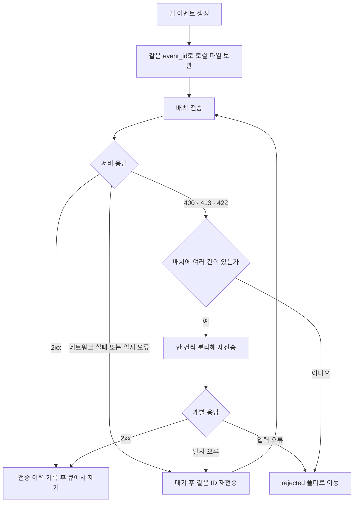

# 예외 처리와 최적화

앱 소스, 메인 서버 담당 보고, 실제 AWS MongoDB 시험을 기준으로 정리했습니다. 서비스 적용, 제공 코드 확인, 별도 시험, 후속 검증의 범위를 각 항목에 표시합니다.

## 구현·검증 범위

| 계층 | 적용한 처리 | 근거·상태 |
|---|---|---|
| 앱 입력 | 짧은 구간·미검출·낮은 확률을 구분해 결과 표시 | 제공 앱 코드 확인 |
| 앱 로컬 저장 | 이벤트 파일을 먼저 저장하고 수락 후 삭제 | iOS Outbox 코드 확인, 실기기 재전송 적재 관측 |
| 앱 통신 | 일시 실패 시 지수 백오프, 최대 30초 간격 재시도 | iOS Outbox 코드 확인 |
| 앱 배치 | 배치 거절 시 한 건씩 분리해 정상 이벤트를 전송 | iOS Outbox 코드 확인 |
| API | 인증, 종류별 허용 필드, 건수·크기 검증 | 서버 보고와 기존 400·401 관측 |
| Kafka | 발행 확인 뒤 API 수락 응답 | 서버 담당 보고 |
| Spark | 체크포인트, 상시 소비, 누락 오프셋 재처리 | 서버 담당 보고 |
| MongoDB 원장 | event_id를 문서 키로 사용 | 실제 구조 확인, 서버 중복 방지 구현 보고 |
| MongoDB 조회 | topic·offset 복합 인덱스 | 실제 AWS 적용·실행 계획 검증 |
| DB 입력 오류 | 고유 키·JSON Schema 오류·재시도 동작 | 별도 임시 컬렉션 합성 시험 |
| 계정 간 통신 | PrivateLink, TLS 필수, CA·사용자 인증 | 연결·인증·실제 적재 확인 |
| 운영 주소 | 메인·DB Elastic IP | 팀 보고와 DB 콘솔 확인 |

## 앱 입력의 예외 처리

### 유효한 동작 구간 확보

`Segmenter`는 너무 짧거나 프레임이 부족한 구간을 `tooShort`로 반환합니다. 0.5초 미만과 구간 안 2프레임 미만을 검사하고, 최대 약 3초에서 구간을 종료합니다. 자동 구간은 손 검출 상태를 확인하며 연속 구간 시작을 제어합니다.

`BoardModel`에는 자동 종료 직후 약 0.6초 동안 버튼으로 새 읽기를 시작하지 않는 처리가 있습니다. 종료하려던 클릭이 다음 인식을 바로 시작하는 상황을 줄이기 위한 조치입니다.

### 사람·손 선택과 미검출 처리

`FrameBuilder`는 어깨 너비 기준으로 대상 사람을 고르고, 대상 손목에서 너무 먼 손을 제외합니다. 전처리는 미검출 좌표를 모델 입력에 맞춰 처리하고, 별도로 동작 손의 미검출 비율을 계산합니다.

제공 앱은 미검출 비율이 0.5를 넘으면 `hands_unseen`, 최고 확률이 임시 기준 0.6보다 낮으면 `unsure`, 최고 라벨이 기타이면 `unknown`으로 구분합니다. 카메라 권한 거부와 모델 준비 실패도 오류 상태로 처리합니다. 이러한 분기는 코드에서 확인했으며, 모든 기기 조건에서의 오검출 감소율은 측정 전입니다.

## Outbox와 재전송



위 흐름은 제공된 iOS `Outbox.swift` 기준입니다. Android의 큐 구현과 모든 세부 정책이 동일하다고 가정하지 않습니다.

| 기술 | 실제 구현 | 목적·제약 |
|---|---|---|
| 로컬 선저장 | `.json` 파일을 큐에 보관하고 atomic 쓰기 사용 | 전송 전 기록 보관. OS·디스크 오류의 완전한 복구 보장까지 검증한 것은 아님 |
| 중복 송신 진입 제어 | flushing 상태 가드와 defer 해제 | 같은 Outbox의 flush 중첩 실행 방지. 서버의 동시 쓰기 제어와는 별도 |
| 통신 시간 제한 | URLSession 요청 15초·리소스 60초 | 응답 지연을 무한 대기하지 않도록 설정 |
| 지수 백오프 | 2초에서 시작해 4·8·16·최대 30초 대기 | 장애 중 반복 요청 간격 조절 |
| 응답 분류 | 2xx 수락, 400·413·422 거절, 401·403·404 등 재시도 상태 | 입력 문제와 연결·설정 문제의 대응 구분 |
| 배치 분리 | 거절된 배치를 개별 요청으로 재시도 | 한 이벤트의 오류가 정상 이벤트까지 계속 막는 상황 완화 |
| 추적 로그 | 최근 500건의 event_id·HTTP 상태 등을 sent.log에 보관 | 앱 전송과 서버·Kafka·DB 대조 |
| 큐 상한 | 이벤트 5,000건, 샘플 300건, rejected 200건 제한 | 기기 저장 공간 제한. 상한 초과 시 이전 기록 제거 가능 |

재시도 구현은 무제한 보관이나 전송 성공의 보장이 아닙니다. 코드에는 파일 오류를 `try?`로 처리하는 부분과 큐 정리 로직이 있어, 저장 공간 부족·장기 장애 상황의 데이터 보존은 추가 검증 대상입니다. 지수 백오프에 무작위 지연을 추가하는 jitter와 다수 단말의 동시 재시도 부하도 현재 검증되지 않았습니다.

## API와 메시지 발행 경계

서버 담당 보고 기준으로 FastAPI는 `X-API-Key`, 이벤트 종류별 필드, 배치 최대 100건, 본문 최대 1MB를 검증합니다. 모든 이벤트의 Kafka 발행을 확인한 뒤 202를 반환합니다.

실제 협업 중 `lesson_ended`·`lesson_completed`에 불필요한 `attempt`를 붙이거나, `answer_selected`에 허용하지 않는 항목을 넣어 400이 발생한 사례가 앱 문서에 기록돼 있습니다. 이벤트 종류별 필드 규격을 맞추고 과거 큐 데이터의 불필요한 필드를 처리하는 iOS 코드를 확인했습니다.

이 구조에서는 Kafka 발행 후 HTTP 응답이 유실되면 앱이 같은 이벤트를 다시 보낼 수 있습니다. 따라서 소비·저장 단계는 같은 event_id의 반복을 허용해야 합니다. Kafka 발행 중 배치 일부만 성공한 경우도 같은 정책으로 회복하는지 추가 시험해야 합니다.

## Spark의 재시작과 누락 재처리

서버 담당자는 Kafka 소비 위치를 체크포인트에 보존하고 컨테이너 자동 재시작 정책을 적용했다고 보고했습니다. 누락 이벤트는 다음 순서로 처리했습니다.

1. Kafka에 해당 이벤트가 존재하는지 파티션·오프셋으로 확인합니다.
2. 상시 작업의 세션 필터와 출력 저장소를 조사합니다.
3. 누락 범위 437~440의 4건을 별도 Spark 배치로 읽습니다.
4. 기존 24건과 합친 28건을 원장에서 대조합니다.

이 재처리는 서버 담당자 제공 검증 결과입니다. 체크포인트 유지·재처리 성공과, 원장 저장 직후 집계 저장 전 장애가 발생했을 때의 정합성은 서로 다른 시험입니다. 실제 서비스의 중간 쓰기 실패·재시작 시험은 후속 항목으로 남아 있습니다.

## MongoDB 원장 중복 방지

이벤트 ID를 `_id`로 사용하면 문서의 고유성을 DB 제약으로 관리할 수 있습니다. 별도 임시 컬렉션에서는 아래 패턴을 시험했습니다.

```javascript
// 임시 컬렉션에서 검증한 패턴
collection.updateOne(
  { _id: event.event_id },
  { $setOnInsert: eventDocument },
  { upsert: true }
)
```

| 입력 상황 | 시험 결과 |
|---|---|
| 처음 보는 ID | 문서 생성 |
| 같은 ID·같은 내용 재전송 | 문서 1건 유지 |
| 같은 ID·다른 내용 | 최초 문서 보존 |
| 같은 ID로 insert 강제 실행 | 중복 키 오류 11000 |
| 시험 validator의 음수 offset | 문서 검증 오류 121 |

`$setOnInsert`는 기존 값의 덮어쓰기를 막지만 내용 충돌을 자동으로 보고하지 않습니다. 이 시험은 DB 저장 패턴의 동작 확인이며, 실행 중인 서버 코드에 해당 패턴과 validator를 새로 배포한 이력으로 표현하지 않습니다. 실제 서버의 같은 ID 충돌 처리·동시 쓰기 정책은 서버 소스로 확인해야 합니다.

## 조회 최적화의 전후

조회 조건은 특정 topic, offset 내림차순, limit 10입니다. `_id` 인덱스만 있던 상태에서 다음 인덱스를 실제 원장에 추가했습니다.

```javascript
{ topic: 1, offset: -1 }
// 인덱스 이름: topic_offset_desc
```

topic의 동등 조건을 먼저 탐색하고 offset 순서를 따라 읽는 구성입니다. `explain("executionStats")`로 최근 조회와 범위 조회를 전후 비교했습니다.

| 항목 | 적용 전 | 적용 후 |
|---|---|---|
| 실행 계획 | COLLSCAN + SORT | IXSCAN + FETCH + LIMIT |
| 검사 문서 | 73 | 10 |
| 검사 인덱스 키 | 0 | 10 |
| 반환 문서 | 10 | 10 |
| 전체 BSON 해시와 순서 | 비교 기준 | 일치 |

문서 검사량은 약 86.3% 줄었습니다. 데이터 규모 73건, 실행 시간 0~1ms라는 조건을 함께 제시합니다. 대규모 데이터에서의 조회 지연, 쓰기 비용, 인덱스 용량은 별도 측정 대상입니다.

## 실제 문제 해결 사례

| 관측 문제 | 조사한 구간 | 조치·현재 상태 |
|---|---|---|
| 202를 받았지만 원장에 없음 | Kafka 적재, Spark 필터, 저장 대상 | 시험 세션 필터·SQLite 작업을 확인하고 MongoDB 상시 작업으로 연결 |
| 앱 요청 400 | 이벤트별 JSON 허용 필드 | 앱 필드 구성·규격 조정, 큐 데이터 호환 처리 확인 |
| 노트북 조회 연결 실패 | DB EC2 퍼블릭 주소 | 새 IP 반영 후 조회 성공, 이후 Elastic IP 연결 |
| 서버 계정 간 직접 경로 필요 | VPC·PrivateLink·NLB·TLS | 사설 접속과 MongoDB 인증 확인 |
| 작은 최근 조회가 전체 문서 검사 | MongoDB 실행 계획 | 복합 인덱스 추가 후 73→10 확인 |
| 여러 단말 기록 혼합 | user_id·session_id·device | 두 아이폰·Android 기록의 식별자 대조 |

## 참고 근거

- 앱 ZIP의 `ios-board/KSLBoard/Sync/Outbox.swift`, `SyncCenter.swift`, `Engine/BoardModel.swift`, `ios/KSLSign/Core/Segmenter.swift`, `FrameBuilder.swift`를 직접 검토했습니다.
- 서버 동작·배포·누락 재처리는 제공된 `aws-deployment-and-data-pipeline.md`에 근거합니다.
- 실제 DB 적용과 시험 수치는 [검증 결과](verification.md)에 정리했습니다.
