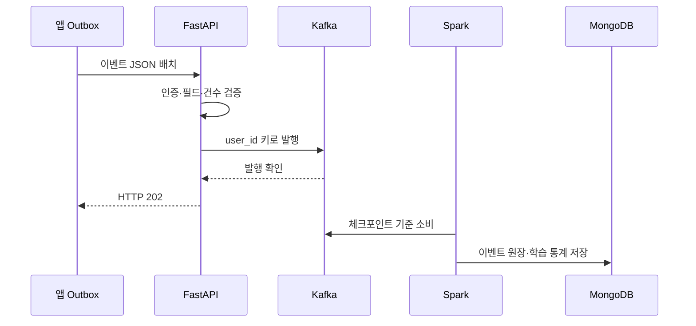

# Kafka·Spark 수집과 처리

팀에서 운영한 수집·소비·집계·재처리 경로를 설명합니다. 서버 동작은 제공된 aws-deployment-and-data-pipeline.md, Kafka 위치와 MongoDB 적재는 팀의 대조 결과에 근거합니다.

## 이벤트 수집과 API 계약

FastAPI는 X-API-Key 인증, 이벤트 종류별 필드, 배치 최대 100건, 본문 최대 1MB를 검증합니다. Kafka 발행을 확인한 뒤 HTTP 202를 반환합니다. 앱은 수락된 이벤트를 Outbox에서 제거하고, 통신 실패 시 같은 event_id로 다시 보냅니다.

HTTP 수락과 DB 저장은 비동기 처리의 서로 다른 관측 지점입니다. 최종 적재는 event_id로 원장을 조회해 확인했습니다.

## 토픽·키·처리 위치

| 항목 | 실제 사용 내용 | 역할 |
|---|---|---|
| 시험 토픽 | sign-learning-events-v1-test-mwoca3fd | 모바일 학습 이벤트 수집 |
| 메시지 키 | user_id | 사용자 이벤트의 파티션 배치 기준 |
| 관측 파티션 | 시험 메타데이터 1개, 대조 파티션 0 | 파티션 내부 순서·소비 위치 확인 |
| offset | Kafka 파티션 내부 메시지 위치 | 누락 범위와 처리 결과 대조 |
| event_id | 앱 이벤트 식별자, 원장 _id | 재전송된 논리 이벤트 구분 |

동일 이벤트를 재발행하면 새로운 Kafka 오프셋이 생길 수 있습니다. 팀은 메시지 위치와 앱 이벤트 ID를 함께 대조했습니다. 원장에는 topic·offset·payload와 event_id 기반 _id를 저장했습니다.

## 입력 필드와 시간

앱 이벤트에는 schema_version, event_type, event_id, user_id, session_id, event_time과 종류별 추가 값이 포함됩니다. API는 종류별 계약으로 요청을 검증합니다. 실제 협업에서 규격 밖 필드로 발생한 HTTP 400을 이벤트별 필드 조정과 iOS 큐 호환 처리로 다뤘습니다.

- event_time: 앱에서 동작이 발생한 시각
- sent_at: 앱이 배치를 전송한 시각
- received_at: 서버가 배치를 수신한 시각

시각은 UTC ISO 8601로 보존하며, 기록 발생과 재전송·수신을 구분하는 데 사용했습니다.

## 학습 통계

다음 집계는 서버 담당자의 구현 보고에 포함됩니다. 분모 설명은 제공 앱 규격에 근거합니다.

| 지표 | 원천 | 계산 의미 |
|---|---|---|
| 1분 단어별 연습 횟수 | practice_attempt | 단어·시간 구간별 시도 건수 |
| 최근 5분 미인식 비율 | recognition_result | unsure·unknown·hands_unseen·no_hands·too_short / 인식 결과 |
| 사용자 확인 일치율 | answer_selected | 사용자 확인 기록 중 was_corrected=false 비율 |

wrong_word는 목표와 다른 단어로 판정한 결과로, 앱 규격의 미인식 분자와 구분합니다. 사용자가 확인한 결과의 일치율과 모델의 독립 평가 정확도도 구분합니다.

## 체크포인트와 누락 재처리

서버 담당자는 Spark 체크포인트로 Kafka 소비 위치를 관리하고, 컨테이너 자동 재시작 정책을 적용했습니다. EC2 중지·시작 후 PrivateLink 인증과 후속 이벤트 16건의 저장을 확인했다고 보고했습니다.

실제 누락 조사에서는 Kafka에 레코드가 있었지만 시험 세션 필터·SQLite 출력으로 MongoDB 원장에 보이지 않는 상황을 확인했습니다. 실제 앱 세션을 받는 MongoDB 상시 작업으로 연결하고 다음 재처리를 수행했습니다.

1. Kafka에서 누락 이벤트의 파티션·오프셋을 확인했습니다.
2. 오프셋 437~440의 4건을 별도 Spark 배치로 읽었습니다.
3. 기존 24건과 합친 총 28건을 원장에서 대조했습니다.

상시 Spark의 아이폰 이벤트 504~560 총 57건도 ID·오프셋·원문 일치가 보고됐습니다. 두 수치는 서로 다른 대조 범위의 결과입니다.

## 재전송 원장 관리

앱은 재전송에서 event_id를 유지하고 MongoDB 원장은 그 값을 _id로 사용합니다. 별도 임시 컬렉션 시험에서는 upsert와 $setOnInsert 조합으로 같은 이벤트를 반복 입력해도 한 건을 유지하고 최초 내용을 보존하는 동작을 확인했습니다.

[예외 처리·최적화](reliability-and-optimization.md) · [실제 검증](verification.md)

## 실행 소스로 확인한 실습의 처리 의미

추가한 영상·특징 실습에서는 Kafka 입력 검증, 명시 스키마의 원장 DataFrame, F.window의 1분 Tumbling 집계, 고유 키·fingerprint·절대값 출력과 checkpoint 설정을 코드로 확인할 수 있습니다. 이벤트 시간은 Kafka 발행 시각입니다. 모바일의 학습 로그 계약과는 분리해 [구현·복구 문서](prototype-pipeline.md)에 연결했습니다.
